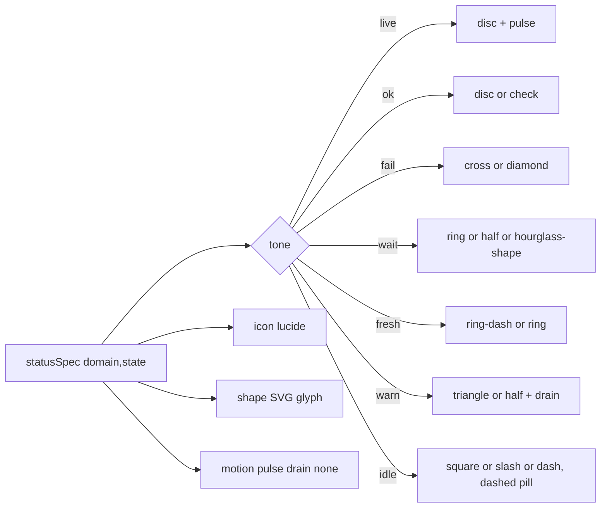

# burrow design system

The normative design language for the burrow web UI. Values are copied verbatim from the source of truth named beside
each one; where the code does not decide a question the answer is labelled **proposed** and is a convention, not a fact.

Sources of truth, in precedence order:

1. `web/src/styles/tokens.css` — fixed medium layout token values, dark/light themes, contrast, `@theme inline` bridge.
2. `web/src/styles/app.css` — variants, motion gating, keyframes, tone/pill/thread/skeleton CSS, z-index utilities.
3. `web/src/design/status.ts` — THE status table.
4. `web/src/ui/*` — how primitives turn tokens into pixels (`status.tsx`, `datum.tsx`, `progress-bar.tsx`, `data-table/`, `feedback.tsx`, `button.tsx`, `ticker.tsx`).
5. `docs/contracts/parity-dom.md`, `docs/contracts/api.md`, and `docs/design-dag.md` (DAG implementation detail; §7 here is the design superset and wins on intent).

---

## 1. Point of view

burrow is an **ops console**, not a dashboard toy. The aesthetic thesis: **the cluster is a loom** — `ground`,
`fabric`, `seam`, `ink` — and **liveness is a thread**. Your job as an engineer here is to make a dense, tabular surface
that a sleepy on-call engineer can read at 03:00 without decoding decoration.

Concretely, that means:

- **Dark-first.** Dark is `:root`; light is `html[data-theme="light"]`. Both are first-class; neither is a filter over
  the other. Design dark, then verify light.
- **Calm and orderly.** 34px rows by default (44px on coarse-pointer devices for touch targets), 14px body text,
  13px cell text, and tabular numerals everywhere. Use flat panels and seams to group related information; metric grids
  adapt to the available page width. Avoid oversized hero numbers and decorative gradients.
- **Tabular by default.** The unit of information is a row with stable column widths, not a tile. Lists are linkable:
  sort/columns/filters live in the URL.
- **Flat cool-neutral surfaces.** Slate-tinted grounds, fabrics and wells carry the interface; seams define edges, while
  status and chart hues carry meaning.
- **Status is never colour alone.** Every state carries an icon (pills), a shape (dots/DAG corners/timeline bars) and
  optionally motion; colour is the third signal, never the first.
- **Motion is meaning, not delight.** Three status semantics (`pulse`/`drain`/`none`). Loops key off
  `useInView().visible` and are dropped entirely under reduced motion / parity mode.
- **Every datum is testable.** All upstream YARN/Spark values render through `Datum` inside an `Entity`; the raw value is
  a DOM attribute, never the formatted text.
- **Boring structure.** One `DataTable`, one `StatusPill`, one `ProgressBar`, one `Datum`. New pages compose them rather
  than inventing a second convention.

A new engineer's decision rule: if a choice would make two rows of the same table disagree in rhythm, or would make a
status readable only by colour, it is wrong.

---

## 2. Colour

The core palette uses flat hex colours. Dark is `:root`, light is `html[data-theme="light"]`. Tailwind consumes them through the
`@theme inline` bridge (`bg-fabric`, `text-ink-3`, `border-seam`, `text-live`, …), so utilities and raw `var(--token)`
always agree.

### 2.1 Surfaces (ground / fabric / well)

Named surfaces form a small flat palette. Use the nearest existing token before adding a new surface.

| token | dark | light | role | use when |
|---|---|---|---|---|
| `--ground` | `#090d12` | `#edf2f5` | page background | the app shell, behind everything |
| `--ground-raised` | `#0d1218` | `#f4f7f9` | shell surfaces | navigation rail and top bar |
| `--fabric` | `#111820` | `#ffffff` | panels / table surface | bordered page sections and cards |
| `--fabric-2` | `#161f29` | `#f6f9fb` | raised / sticky header | table header, toolbars, popover bodies |
| `--fabric-3` | `#1d2934` | `#e7eef2` | hover / active row | row hover, active row, button hover, skeleton base |
| `--well` | `#070a0e` | `#e8eef2` | inset wells | code blocks, `kbd`, error detail, scroll wells |

`--ground-raised` is for the shared shell. Prefer `--fabric` for content panels and `--well` for inset details.

### 2.2 Ink (text tiers)

| token | dark | light | role | use when |
|---|---|---|---|---|
| `--ink` | `#f4f8fb` | `#111820` | primary text | body, headings, values the user reads |
| `--ink-2` | `#c0ccd6` | `#33424e` | secondary text | supporting copy, labels beside values |
| `--ink-3` | `#8fa0ae` | `#536571` | tertiary text | column headers, hints, metadata, hints/tooltips |
| `--ink-4` | `#71818e` | `#667783` | quaternary / decorative | keyboard cheat text and non-essential glyphs; not the sole carrier of essential text |

### 2.3 Seams (borders)

| token | dark | light | role |
|---|---|---|---|
| `--seam` | `#28333d` | `#cbd6dc` | standard border |
| `--seam-soft` | `#1b252e` | `#dee6ea` | row separator, subtle divider |
| `--seam-strong` | `#3e4e5c` | `#9eb0ba` | control border, scrollbar thumb, resize handle |

### 2.4 Dyes (status hues)

Each dye is a foreground; tints are derived at use-site with `color-mix(in oklch, …)`.

| token | dark | light | meaning |
|---|---|---|---|
| `--live` | `#4cd7d7` | `#007d80` | **the thread**: active work, focus, selection, liveness |
| `--ok` | `#5ed991` | `#167a44` | healthy / succeeded / complete |
| `--fail` | `#ff747b` | `#b42331` | failed / lost / unreachable |
| `--wait` | `#f4c95d` | `#8a5b00` | accepted / pending / standby |
| `--fresh` | `#82a7ff` | `#365fb5` | new / submitted / not-yet-running |
| `--warn` | `#ffad66` | `#a94c19` | degraded / unhealthy / draining / partial failure |
| `--idle` | `#9aabb8` | `#596a76` | finished / killed / stopped / disabled — neutral |
| `--on-live` | `#041c1e` | `#ffffff` | text/icon on a `--live` fill |

`--focus: var(--live)` and `--selection: color-mix(in oklch, var(--live) 28%, transparent)`.

Rule: a dye means one thing everywhere. `--live` is never used for decoration; `--idle` is never used to mean "ok".

Rule: `--tone` is set by `burrow-tone-*` on a wrapper, so anything painted with `var(--tone)` — SVG `fill`/`stroke`
especially — must sit inside an element that carries the class. An unresolved `var(--tone)` is not an error the browser
reports: SVG paint falls back to its initial value and the shape renders **black** in both themes (the Spark timeline's
bars shipped that way). `Timeline.test.tsx` guards the pattern structurally.

### 2.5 Series dyes (charts / task-time phases)

| token | dark | light |
|---|---|---|
| `--dye-1` | `#4cd7d7` | `#007d80` |
| `--dye-2` | `#82a7ff` | `#365fb5` |
| `--dye-3` | `#f4c95d` | `#8a5b00` |
| `--dye-4` | `#ffad66` | `#a94c19` |
| `--dye-5` | `#ff747b` | `#b42331` |
| `--dye-6` | `#5ed991` | `#167a44` |

Used in series order for multi-series charts and for timeline phase colouring (§7). `dye-1` == `live`; do not rely on the
duplication to distinguish meanings.

### 2.6 Overlays, scrim, shadows

| token | dark | light |
|---|---|---|
| `--scrim` | `rgb(7 10 14 / 72%)` | `rgb(33 49 60 / 34%)` |
| `--ring-overlay` | `0 0 0 1px var(--seam-strong)` | `0 0 0 1px var(--seam-strong)` |
| `--shadow-overlay` | `0 0 0 1px var(--seam-strong), 0 18px 48px rgb(0 0 0 / 32%)` | `0 0 0 1px var(--seam), 0 1px 2px -1px rgb(33 49 60 / 10%), 0 18px 48px rgb(33 49 60 / 16%)` |

Popovers/menus/dialogs use `--shadow-overlay`; the modal scrim uses `--scrim` (`.burrow-scrim`). Elevation is a seam plus a
soft drop shadow — never a second fill.

### 2.7 Contrast rules

Ratios below use the WCAG sRGB formula against the full-opacity hex surfaces in §2.1. `--ink`, `--ink-2`, and `--ink-3`
stay above 4.5:1 across the content surfaces. `--ink-4` reaches 4.15:1 in dark mode and 3.96:1 in light mode; reserve it
for decorative or duplicated text, never for a value or instruction the user needs to act on. Recalculate when changing
the palette.

Status dyes are not text-contrast tokens: their minimum against the listed surfaces is 6.37:1 in dark mode and 4.23:1 in
light mode. Keep status meaning explicit in its label and shape/icon, and use the palette's dye for accent and emphasis.
`StatusPill` tint uses a surface wash with `color-mix(in oklch, var(--tone) 13%, transparent)` and a 32% dye border.

- **`prefers-contrast: more`** (tokens.css): dark `--seam` → `oklch(1 0 0 / 0.34)`, `--seam-soft` → `/0.22`,
  `--seam-strong` → `/0.6`, `--ink-2` → `oklch(0.9 0.008 255)`, `--ink-3` → `oklch(0.8 0.01 255)`, `--ink-4` →
  `oklch(0.68 0.01 255)`; light `--seam` → `oklch(0.2 0.02 255 / 0.45)`, `--seam-soft` → `/0.3`, `--seam-strong` →
  `/0.8`, `--ink-2` → `oklch(0.25 0.016 255)`, `--ink-3` → `oklch(0.33 0.014 255)`, `--ink-4` → `oklch(0.42 0.012 255)`.
  Status shapes get solid outlines: `.burrow-pill { border-color: currentColor !important; }`.
- **`forced-colors: active`**: `.burrow-pill, .burrow-thread { border: 1px solid CanvasText; }` and
  `.burrow-thread-fill { background: Highlight !important; }`. Every status still has a shape/icon, so meaning survives the
  loss of dye colour.

### 2.8 Burrow logo

The Burrow lockup pairs the lowercase wordmark with an upright tunnel arch. Inside the arch, a compact left-facing chevron links three colored data nodes. Keep the wordmark in the SVG lockup; use the standalone mark only where the rail is collapsed.

- `web/src/features/shell/BurrowBrand.tsx` renders the full lockup and compact mark inline, so the logo artwork has no standalone public image URL.
- The dark nodes use `--live` `#4cd7d7`, `--fresh` `#82a7ff`, and `--wait` `#f4c95d`; light mode uses `#007d80`, `#365fb5`, and `#8a5b00`.
- `web/src/features/shell/rail.tsx` selects the full lockup or compact mark; `web/src/styles/app.css` selects the theme variant.
- `web/public/favicon.svg` is the Burrow tunnel mark; `favicon.ico` is its legacy-browser fallback.


---

## 3. Typography

### 3.1 Fonts (self-hosted, no runtime network)

`web/src/styles/fonts.css` declares two `@fontsource-variable` families, latin + latin-ext only, `font-display: swap`:

- `"IBM Plex Sans Variable"` — weight axis `100 700`. Bridged as `--font-sans: "IBM Plex Sans Variable", ui-sans-serif, system-ui, sans-serif`.
- `"JetBrains Mono Variable"` — weight axis `100 800`. Bridged as `--font-mono: "JetBrains Mono Variable", ui-monospace, "SFMono-Regular", Menlo, monospace`.

`html` uses `--font-sans` at `font-size: 16px`, `-webkit-font-smoothing: antialiased`, `text-size-adjust: 100%`,
`font-feature-settings: "ss01" 0, "kern" 1, "calt" 1`. `body` is `--text-body`, `line-height: 1.55`.

### 3.2 Type scale

From `@theme inline`:

| token | value | use |
|---|---|---|
| `--text-micro` | `10.5px` | kbd, dense badges, cheat text, pill `sm` |
| `--text-caption` | `11.5px` | pill `md`, timestamps, minor labels |
| `--text-small` | `12px` | column headers, secondary UI text |
| `--text-body` | `var(--d-body)` (14px medium) | page body |
| `--text-cell` | `var(--d-cell)` (13px medium) | table cells |
| `--text-lead` | `15px` | empty/error state titles |
| `--text-h3` | `18px` | section headings |
| `--text-h2` | `22px` | page headings |
| `--text-h1` | `28px` | top-level heading |
| `--text-metric` | `34px` | a single headline metric on a detail page |
| `--text-display` | `44px` | hero number, overview only |

`--text-body` is 14px and `--text-cell` is 13px in the fixed medium layout; the other type sizes are fixed. Do not add intermediate sizes.

### 3.3 Numerals, mono, headings, wrapping

- **Tabular numerals are mandatory where numbers live**: `app.css` applies
  `font-variant-numeric: tabular-nums; font-feature-settings: "tnum" 1, "zero" 0` to `.tnum`, `table`, `[data-yf]`, and
  `input[type="number"]`. `Ticker` and the metric readouts rely on this so digits do not jitter.
- **Mono** (`.mono`, and `code, kbd, samp, pre`) uses `--font-mono` with `font-feature-settings: "calt" 0, "zero" 1`
  (slashed zero) and `letter-spacing: -0.01em`. Use mono for identifiers (app/container/node ids, queue paths, class
  names), byte/record counts only where column alignment matters, and keyboard glyphs. Do **not** set whole tables in
  mono.
- **Headings**: `h1–h4` are `font-weight: 600`, `letter-spacing: -0.012em`, `text-wrap: balance`, `margin: 0`.
- **Paragraphs**: `p { text-wrap: pretty; margin: 0; }`.
- **Line height**: 1.55 globally; single-line UI (pills, buttons) uses `leading-none`/fixed control heights rather than
  the body ratio.
- Dense tabular text retains the compact line-height provided by its row and control sizing.

---

## 4. Space, radius, elevation, sizing

### 4.1 Spacing rhythm

The layout rhythm uses Tailwind's 4px base, evident in the primitives (`gap-2` = 8px, `p-2.5` = 10px, `px-3` = 12px).
Page gutters scale with the viewport, while fixed rhythm values line up across components:

- `--cell-px` — horizontal cell padding, fixed at 10px for the medium layout.
- `--gap-card` — gap between cards/panels in a grid, fixed at 16px for the medium layout.
- `--page-gutter-x` — `clamp(16px, 3vw, 40px)`; `--page-gutter-y` — `clamp(20px, 2.5vw, 40px)`.

Authors use the 4px scale where practical; nested panel padding is sized to the content, and page gutters use the responsive tokens.

### 4.2 Radius — concentric, inner = outer − padding

| token | value |
|---|---|
| `--r-xs` | `4px` |
| `--r-sm` | `6px` |
| `--r-md` | `10px` |
| `--r-lg` | `14px` |
| `--r-xl` | `18px` |

Bridged as `--radius-xs` … `--radius-xl`. Rule: an inner element's radius equals the outer radius minus the padding
between them, so curves stay concentric (a card at `--r-lg` with 4px padding holds a child at `--r-md`). Pills are
`rounded-full`. Focus rings use `--r-xs`. `ProgressBar` uses `99px`.

### 4.3 Elevation and the z-index scale

Elevation is seam + shadow, not a lighter fill:

- surfaces: `--fabric` panel on `--ground`, header on `--fabric-2`.
- popovers/menus/dialogs: `--shadow-overlay` (with `--ring-overlay` for the 1px edge).
- modal backdrop: `.burrow-scrim` with `--scrim`.
- entrance/exit: `.burrow-pop` (opacity + `scale(0.96)`), `.burrow-sheet` (translateX/Y by side).

**Fixed z-index scale** — no arbitrary `z-*` anywhere (utilities in `app.css`):

| utility | z-index | layer |
|---|---|---|
| `z-sticky` | 10 | sticky table header |
| `z-rail` | 20 | nav rail |
| `z-topbar` | 30 | top bar |
| `z-overlay` | 50 | dialog / sheet |
| `z-popover` | 60 | popover / menu |
| `z-toast` | 70 | toasts |
| `z-tooltip` | 80 | tooltips |

Tooltips are above toasts; toasts above popovers; popovers above the overlay.

### 4.4 Fixed medium sizing

Burrow uses one medium sizing profile; there is no density preference or selector. These token values are fixed in
`:root`. The rail is 248px wide, the top bar is 56px high, and page gutters follow the responsive tokens in §4.1. Legacy
`density` entries in `burrow.prefs.v1` are ignored and removed from in-memory preferences. DataTable rows
adapt from 34px to 44px on coarse-pointer devices so row links remain comfortable touch targets; this is an input-mode
adaptation, not a user-selectable density profile.

| token | value | affects |
|---|---|---|
| `--row-h` | `34px` | table row height (matches `ROW_HEIGHT` in data-table.tsx) |
| `--cell-px` | `10px` | cell/header horizontal padding |
| `--ctl-h` | `34px` | button/input/select control height |
| `--d-body` | `14px` | `--text-body` |
| `--d-cell` | `13px` | `--text-cell` |
| `--gap-card` | `16px` | inter-card gap |

`Button` derives its `sm`/`icon-sm` sizes as `calc(var(--ctl-h) - 4px)` from the same fixed control token.

---

## 5. Motion

### 5.1 Tokens

| token | value | use |
|---|---|---|
| `--ease-out` | `cubic-bezier(0.22, 1, 0.36, 1)` | entrances, hovers, popovers |
| `--ease-in-out` | `cubic-bezier(0.4, 0, 0.2, 1)` | on-screen movement (progress fills, tab indicator, ring arcs) |
| `--ease-drawer` | `cubic-bezier(0.32, 0.72, 0, 1)` | long slides (left/bottom sheets, the mobile rail drawer) |
| `--dur-instant` | `0ms` | immediate |
| `--dur-fade` | `120ms` | opacity/colour state changes; the short fade that survives reduced motion |
| `--dur-content` | `220ms` | route and tab content fades; aliases to `--dur-fade` under reduced motion and zeroes in parity |
| `--dur-fast` | `160ms` | hover, button press, chip entrance |
| `--dur-base` | `240ms` | popover/scrim entrance, mount entrances, dim/brighten, single, segmented and share progress fills plus ring arcs |
| `--dur-slow` | `320ms` | DAG fallback segment movement, long list moves |
| `--dur-sheet` | `360ms` | sheet slide |
| `--dur-tween` | `480ms` | number tween (`Ticker` default `durationMs = 480`) |
| `--dur-flash` | `900ms` | row/line change flash (`flash()` in `lib/motion.ts`); `/apps` opts out of row flashes so polling stays quiet |

The easing table is the decision order: **entering or exiting → `--ease-out`**; **moving or morphing on screen →
`--ease-in-out`**; **constant motion (marquee, needle, dash flow) → `linear`**; **hover/colour → `--ease-out`**. Built-in
`ease`, `ease-in` and `ease-out` keywords are too weak for UI and `ease-in` is never used on an entrance (it delays the
exact moment the user is watching). Direct click feedback usually stays inside 100–250ms. Sheets use the longer
`--dur-sheet`; number changes use `--dur-tween` so large values remain easy to follow; `--dur-flash` is an after-the-fact cue.

### 5.2 The three status-motion semantics (from `status.ts`)

- `pulse` — breathing ring: live work that is executing or heartbeating (`.burrow-dot-pulse::after`, `burrow-pulse-ring`).
- `drain` — slow fade: winding down / draining (`burrow-drain`, opacity 1 → 0.55, alternate).
- `none` — static.

Status declares the semantics; components implement them consistently (§6). `StatusDot` and `StatusPill` add a pulse ring
only when a state declares it (the pill puts the ring around its icon). Reduced motion suppresses loops; tone, shape, and
label remain.

Live-status badges use the same pulse ring as `app.state.RUNNING`. A table row containing a pulsing status badge does not
also flash on polling or lifecycle updates; other tables can opt into the generic `rowVersion` row-change feedback.

### 5.3 Gating rule (normative)

Motion is **tiered, not nuked** (reduced motion keeps the cue, drops the movement):

| tier | what | reduced motion | parity mode |
|---|---|---|---|
| 1 — displacement | slides, scales, position changes, drag | removed (duration `0ms`, transform dropped) | removed |
| 2 — loops | pulse, shimmer, drain, dash flow | dropped; a static cue replaces each one | dropped |
| 3 — fades & feedback | entrances, route content, tab content, overlay opacity, focus rings, loading spinners | **kept** — `--dur-fade` (120ms) survives; route/tab content uses `--dur-content` (220ms) normally and falls back to `--dur-fade` under reduced motion; spinners slow to 2.4s. Hover/press *colour* transitions ride `--dur-fast` and therefore snap, which is the conservative default | cut to `0ms` |

- `html[data-motion="reduced"]` sets `--dur-fast/-base/-slow/-sheet/-tween/-flash` to `0ms`; `--dur-content` falls back to the surviving `--dur-fade`.
- `html[data-parity]` sets **every** duration including `--dur-fade` and `--dur-content` to `0ms`, and
  `html[data-parity] *, ::before, ::after` forces `animation: none !important; transition: none !important;
  scroll-behavior: auto !important` — a screenshot can never catch a half-run animation.
- `@media (prefers-reduced-motion: reduce)` mirrors the reduced-motion row (the OS setting does not set the attribute).
- Every loop selector is gated: `html:not([data-motion="reduced"]):not([data-parity]) …` (the `motion-ok` Tailwind
  variant is exactly this predicate), plus a `@media (prefers-reduced-motion: reduce)` `animation: none !important` per
  loop. A loop also keys off `useInView().visible` via `data-visible`, so offscreen work costs nothing.
- JS motion goes through `lib/motion.ts`: `motionAllowed()` (parity ∨ OS reduce ∨ the in-app toggle) and `flash(el)`,
  which reads `--dur-flash` from the computed style. `Ticker` uses `useAnimationsEnabled()` and skips the rAF loop
  offscreen.
- Tailwind's `animate-spin`/`animate-pulse` are not tokens: reduced motion slows them (2.4s) instead of removing them
  (a loading spinner is Tier-3 feedback), and parity kills them with the global rule. New loops use the house classes.
- Meaning must never be motion-only: when a loop is dropped, a **static** cue replaces it (the live thread gains a
  dashed texture, a running DAG node keeps its hatch, and a DAG change keeps a 0.22 tint).

### 5.4 Keyframes and what each is for

| keyframe | motion | purpose |
|---|---|---|
| `burrow-needle` | `translateX(-100%) → translateX(400%)` | thread needle shimmer on a live `ProgressBar` (fill and segmented track) |
| `burrow-pulse-ring` | `scale(0.8)→scale(2.1)`, opacity `0.7→0` | `StatusDot`/`StatusPill` pulse ring for `pulse` states |
| `burrow-skeleton` | `translateX(-100%) → translateX(100%)` | structural skeleton shimmer |
| `burrow-drain` | opacity `1→0.55` alternate | `drain` tone (decommissioning, draining) |
| `burrow-dag-flow` / `burrow-dag-shimmer` / `burrow-dag-flash` | `stroke-dashoffset`, `translateX`, opacity | DAG edge flow, running shimmer, change flash (`features/dag/dag.css`) |

All keyframes animate `transform`/`opacity` only, except the SVG dash offsets (`burrow-dag-flow`, and the ring arcs which
tween `stroke-dashoffset` inline). Entrance *primitives* are transitions, not keyframes, so a re-trigger retargets:

- `.burrow-enter` — 4px rise + fade (panels, detail panes, empty/error states, rail labels on first paint).
- `.burrow-enter-pop` — `scale(0.96)` + fade (chips, floating affordances, the Gantt tooltip).
- `.burrow-page` — the shell keys the page by pathname; its heading swaps immediately, then coarse content groups cascade in with a
  6px rise. Metric cards and Overview sections stagger by the bounded `--delay-cascade-*` cadence (capped at 72ms); rows and live
  cells never move.
- `.burrow-page-scroll` section content — a CSS `view()` timeline reveals direct content blocks after each section heading with an
  8px rise as native scroll enters them. Unsupported browsers and reduced motion keep content static.
- `[role=tabpanel]` fades incoming/outgoing panels with `--dur-content`; `.burrow-tab-content` fades filtered results and explicit visualization modes in place (node table/heatmap, label catalogue/mapping, Overview history ranges, Scheduler treemap basis). Poll-driven geometry and individual rows remain unanimated.
- `.burrow-instant` — zeroes the overlay durations for one subtree (the command palette: keyboard-first, ⌘K/`/`, so it opens
  and closes with no animation at all).
- `.burrow-bar` — a share bar whose fill is `scaleX(var(--fill))`, so a poll re-lays nothing out.
- `.burrow-progress-value` — fixed 3rem, right-aligned, tabular percentage column; use for numeric readouts beside progress tracks.

### 5.5 Adding motion safely

1. Decide *whether* it animates first: keyboard shortcuts and row-focus moves get **no** animation; content-changing tabs get
   an opacity-only `--dur-content` bridge. Page switches keep the heading immediate and use the bounded B cascade only on coarse
   groups/cards; scroll reveals only major sections. Never stagger rows or live cells.
2. Choose a `--dur-*` token; use the named `--delay-cascade-*` offsets for the bounded page sequence. Entrances and exits use
   `--ease-out`, on-screen movement `--ease-in-out`, constant motion `linear`.
3. Animate only `transform`/`opacity` (or SVG dash offset on short paths). Never `scale(0)`; entrances start at
   `scale(0.96)`/4px, or use the bounded 6px/8px page reveals above. Never `transition: all` — name the properties.
4. If it loops, gate it with the motion predicate **and** `useInView().visible`, and add a
   `prefers-reduced-motion` `animation: none` rule.
5. If JS-driven movement/data tween, gate on `motionAllowed()`/`useAnimationsEnabled()` and clean up; the content-only
   `fadeIn()` reads `--dur-content`, falls back under reduced motion, and is disabled by parity.
6. Provide a static equivalent so the meaning survives gating.
7. Do not animate layout properties, `box-shadow`, filters over large areas, or individual rows of the 10k-row table. Tab
   changes may fade the result wrapper with `--dur-content`; never animate each row. Hover motion is pointer-gated (Tailwind
   v4's `hover:` compiles to `@media (hover: hover)`; raw CSS `:hover` needs the media query by hand). Theme changes are
   forced to snap by `data-switching` (a flip that cross-fades every colour on the page reads as a smear, not a state change).
8. Three explicit exceptions to rules 3/7: `.burrow-rail` width moves between 56px and 248px on a user toggle (the main column
   reflows for the 240ms shell transition); the tab indicator tweens `width` alongside `translate` (one absolutely-positioned
   2px bar re-lays out nothing); and the `ResourceRing` tweens `stroke-dashoffset` (a ring cannot be expressed as
   transform/opacity without rotation tricks). No other layout transition.
9. Rejected by this pass: whole-page route slides, unbounded/per-row list entrances, and per-line log entrances (the new-line
   *flash* covers it without dimming text the reader is mid-sentence in); animated
   Gantt bars/marquee/now-line (they *are* the datum), DAG viewport tweens on pan/zoom/fit (direct manipulation; the e2e
   reads the minimap right after a click), chart draw-ins (the line is data), KPI-strip number tweens beyond the
   overview/node-detail/app-detail metrics (`Ticker` already covers those; the scheduler strip is read as a column of
   digits, not as an animation), row reveals on expand in a virtualized tree (rows are positioned by `translateY`, so a
   transform entrance would fight the virtualizer), and converting the app-detail tab strip to client-side navigation
   (it is a *routing* decision — `routes/apps/$appId.tsx` documents the anchors as deliberate — not a motion one).
   The bounded route cascade and scroll-linked section reveal are approved exceptions; neither animates rows or intercepts native scrolling.

10. **Prefs never change the server-rendered shell's *markup*.** A pref that adds, removes or retitles elements/text fails
   hydration — React throws #418 and rebuilds the tree (`railCollapsed: true` once unmounted labels, badges, wordmark and footer
   text). Keep markup stable and express saved shell state in CSS: `theme-init.js` applies `<html data-*>` before paint,
   `RootDocument` mirrors those pre-paint attributes into its client `<html>` props during hydration, and `applyPrefsToDom()`
   owns later updates. The rail keeps every element in the tree and uses those attributes for its first-paint width and user
   toggles. For pref-dependent text or attributes in descendants, use `useMounted()` against `PREF_DEFAULTS` so the first client
   render matches the server. `web/src/features/shell/rail.test.tsx` pins the markup invariant.
11. `web/src/styles/__tests__/motion-contract.test.ts` enforces the mechanical half of this section (no `transition:
   all`, no `ease-in`, no `scale(0)`, every loop gated + escaped, keyframes only on the allowed properties, every
   Tailwind transition carrying a `duration-(--dur-*)` token).

---

## 6. Status language (single table)

THE table. `web/src/design/status.ts` is the only source; lists, detail pages, DAG nodes and timelines must read from
`statusSpec(domain, state)`.

Shapes are 10×10 SVG glyphs (`viewBox="0 0 10 10"`, centre 5,5) in `web/src/ui/status.tsx`:

| shape | glyph |
|---|---|
| `disc` | `<circle cx=5 cy=5 r=3.6 fill>` |
| `ring` | `<circle cx=5 cy=5 r=3.1 fill=none stroke=1.6>` |
| `ring-dash` | ring, `stroke=1.5 strokeDasharray="2 1.6"` |
| `half` | ring `stroke=1.4` + right half-disc fill (a half-filled ring) |
| `square` | `<rect x=1.8 y=1.8 w=6.4 h=6.4 rx=1.3 fill>` |
| `diamond` | `<path d="M5 .9 9.1 5 5 9.1.9 5z" fill>` |
| `cross` | two strokes, `stroke=1.8 round` |
| `slash` | ring `stroke=1.4` + `M2.8 7.2 L7.2 2.8` `stroke=1.4` |
| `dash` | `M2 5 h6` `stroke=1.8 round` |
| `triangle` | `<path d="M5 1.4 9.1 8.6H.9z" fill stroke=.6>` |
| `check` | `M2 5.3 l2 2 l4 -4.6` `stroke=1.8 round` |

### 6.1 The table

Tone ∈ `live | ok | fail | wait | fresh | warn | idle`. Motion ∈ `pulse | drain | none`.

**`app.state`** (`APP_STATE_ORDER = NEW, NEW_SAVING, SUBMITTED, ACCEPTED, RUNNING, FINISHED, FAILED, KILLED`)

| state | label | tone | icon | shape | motion | hint |
|---|---|---|---|---|---|---|
| `NEW` | New | fresh | CircleDashed | ring-dash | none | Application object created, not yet persisted |
| `NEW_SAVING` | New saving | fresh | Save | ring-dash | none | Application is being saved to the state store |
| `SUBMITTED` | Submitted | fresh | Send | ring | none | Submitted, waiting for the scheduler to validate it |
| `ACCEPTED` | Accepted | wait | Hourglass | half | none | Accepted by the scheduler, waiting for the ApplicationMaster container |
| `RUNNING` | Running | live | Activity | disc | pulse | ApplicationMaster is running |
| `FINISHED` | Finished | idle | Flag | square | none | Application ended; see the final status for the verdict |
| `FAILED` | Failed | fail | CircleX | cross | none | Application failed |
| `KILLED` | Killed | idle | Ban | slash | none | Application was killed |

**`app.finalStatus`**

| state | label | tone | icon | shape | motion | hint |
|---|---|---|---|---|---|---|
| `UNDEFINED` | Undefined | idle | Minus | dash | none | No final status yet |
| `SUCCEEDED` | Succeeded | ok | CircleCheck | check | none | Finished successfully |
| `FAILED` | Failed | fail | CircleX | cross | none | Finished unsuccessfully |
| `KILLED` | Killed | idle | Ban | slash | none | Killed by a user or the cluster |
| `ENDED` | Ended | idle | Flag | square | none | Ended (final status not reported) |

**`node.state`**

| state | label | tone | icon | shape | motion | hint |
|---|---|---|---|---|---|---|
| `NEW` | New | fresh | CircleDashed | ring-dash | none | Node registered, not yet running |
| `RUNNING` | Running | live | Activity | disc | pulse | Heartbeating and healthy |
| `UNHEALTHY` | Unhealthy | warn | TriangleAlert | triangle | none | Failing its health script or disk checks |
| `DECOMMISSIONING` | Decommissioning | warn | ArrowDownToLine | half | drain | Draining containers before decommission |
| `DECOMMISSIONED` | Decommissioned | idle | Power | square | none | Removed from the cluster |
| `LOST` | Lost | fail | Unplug | diamond | none | Stopped heartbeating |
| `REBOOTED` | Rebooted | wait | RotateCw | ring | none | Re-registered after a restart |
| `SHUTDOWN` | Shutdown | idle | Power | dash | none | Shut down cleanly |

**`node.health`**

| state | label | tone | icon | shape | motion | hint |
|---|---|---|---|---|---|---|
| `healthy` | Healthy | ok | CircleCheck | disc | none | Health report is empty |
| `unhealthy` | Unhealthy | warn | TriangleAlert | triangle | none | Health report is non-empty |

**`queue.state`**

| state | label | tone | icon | shape | motion | hint |
|---|---|---|---|---|---|---|
| `RUNNING` | Running | live | Activity | disc | pulse | Accepting applications |
| `STOPPED` | Stopped | idle | Square | square | none | Not accepting applications |
| `DRAINING` | Draining | warn | ArrowDownToLine | half | drain | Finishing existing applications, accepting none |

**`container.state`**

| state | label | tone | icon | shape | motion | hint |
|---|---|---|---|---|---|---|
| `NEW` | New | fresh | CircleDashed | ring-dash | none | Allocated, not launched |
| `RUNNING` | Running | live | Activity | disc | pulse | Running on a NodeManager |
| `COMPLETE` | Complete | idle | Flag | square | none | Exited; see exit status |

**`app.logAggregationStatus`**

| state | label | tone | icon | shape | motion | hint |
|---|---|---|---|---|---|---|
| `DISABLED` | Disabled | idle | Ban | slash | none | Log aggregation is off |
| `NOT_START` | Not started | idle | Minus | dash | none | Aggregation has not started |
| `RUNNING` | Running | live | Activity | disc | pulse | Aggregating |
| `RUNNING_WITH_FAILURE` | Running with failure | warn | TriangleAlert | triangle | none | Aggregating, some nodes failed |
| `SUCCEEDED` | Succeeded | ok | CircleCheck | check | none | All logs aggregated |
| `FAILED` | Failed | fail | CircleX | cross | none | Aggregation failed |
| `TIME_OUT` | Timed out | warn | Hourglass | triangle | none | Aggregation timed out |

**`rm.haState`**

| state | label | tone | icon | shape | motion | hint |
|---|---|---|---|---|---|---|
| `ACTIVE` | Active | live | Activity | disc | pulse | This ResourceManager is serving |
| `STANDBY` | Standby | wait | Hourglass | ring | none | Waiting to take over |
| `UNKNOWN` | HA off | idle | Minus | dash | none | High availability is not configured |

**`service`**

| state | label | tone | icon | shape | motion | hint |
|---|---|---|---|---|---|---|
| `reachable` | Reachable | ok | CircleCheck | disc | none | Service responded |
| `unreachable` | Unreachable | fail | Unplug | diamond | none | Service did not respond |
| `configured` | Configured | wait | CircleHelp | ring | none | Service is configured; reachability has not been checked yet |
| `unconfigured` | Not configured | idle | Minus | dash | none | No URL configured or discovered |

**`spark.executor`**

| state | label | tone | icon | shape | motion | hint |
|---|---|---|---|---|---|---|
| `ACTIVE` | Active | live | Activity | disc | pulse | Executor is active |
| `INACTIVE` | Inactive | idle | Ban | slash | none | Executor has stopped |
| `UNKNOWN` | Unknown | idle | CircleHelp | dash | none | Executor activity is not reported |

**`spark.job`**

| state | label | tone | icon | shape | motion | hint |
|---|---|---|---|---|---|---|
| `RUNNING` | Running | live | Activity | disc | pulse | Job has active stages |
| `SUCCEEDED` | Succeeded | ok | CircleCheck | check | none | All stages completed |
| `FAILED` | Failed | fail | CircleX | cross | none | Job failed |
| `UNKNOWN` | Unknown | idle | CircleHelp | dash | none | State not reported |

**`spark.stage`**

| state | label | tone | icon | shape | motion | hint |
|---|---|---|---|---|---|---|
| `ACTIVE` | Active | live | Activity | disc | pulse | Tasks are running |
| `COMPLETE` | Complete | ok | CircleCheck | check | none | All tasks completed |
| `FAILED` | Failed | fail | CircleX | cross | none | Stage failed |
| `PENDING` | Pending | wait | Hourglass | ring | none | Waiting for parent stages |
| `SKIPPED` | Skipped | idle | Ban | slash | none | Output reused from an earlier run |

**`spark.task`**

| state | label | tone | icon | shape | motion | hint |
|---|---|---|---|---|---|---|
| `PENDING` | Pending | wait | Hourglass | ring | none | Waiting for an executor slot |
| `RUNNING` | Running | live | Activity | disc | pulse | Executing |
| `SUCCESS` | Success | ok | CircleCheck | check | none | Completed |
| `FAILED` | Failed | fail | CircleX | cross | none | Task failed |
| `KILLED` | Killed | idle | Ban | slash | none | Killed (speculation or cancel) |

**`spark.sql`**

| state | label | tone | icon | shape | motion | hint |
|---|---|---|---|---|---|---|
| `RUNNING` | Running | live | Activity | disc | pulse | SQL execution is running |
| `COMPLETED` | Completed | ok | CircleCheck | check | none | SQL execution completed |
| `FAILED` | Failed | fail | CircleX | cross | none | SQL execution failed |

### 6.2 Unknown states

`statusSpec(domain, state)` is **total**:

- `null`/`undefined`/empty state → the `UNKNOWN` spec: label `Unknown`, tone `idle`, icon `CircleHelp`, shape `dash`,
  motion `none`, hint "State not recognised by this version of burrow".
- An unrecognised state string → the `UNKNOWN` spec with `label: titleCase(state)` (lowercase, `_` → space, first char
  upper-cased). The raw label is shown; it never crashes and never guesses a tone.

### 6.3 How to use

- **Lists / detail headers** → `StatusPill` (icon + label). Pass `field` + the raw `state` to stamp it as a datum:
  `<StatusPill domain="app.state" state={app.state} field="app.state" />`.
- **Inline cells / dense rows** → `StatusDot` (10px, `size-2.5`, `role="img"` + `aria-label` unless `label={false}`).
- **DAG / timeline** → shape + tone + motion read from the same table; never draw a status as a bare colour swatch.
- **Never colour alone**: pill has an icon; dot has a shape; DAG corner has a shape; timeline bar has a label/legend.
- **`idle` tone is dashed**: `.burrow-pill` sets `border-dashed` when `spec.tone === "idle"`.
- Pill sizing: `sm` = `h-[18px] px-1.5 text-micro`, `md` = `h-5 px-2 text-caption`; icon `size-3`/`size-3.5`,
  `strokeWidth 2.25`; `title` is always `spec.hint`.
- Pill paints `color: var(--tone)` on a `13%` tone wash with a `32%` tone border (`burrow-tone-*` sets `--tone`).

### 6.4 Mapping summary



---

## 7. DAG + timeline visual language (normative)

This section is the contract for the DAG slice. `docs/design-dag.md` documents the implementation in detail; where the
two differ, this section states the intent and `docs/design-dag.md` must be reconciled to it. Engine vocabulary lives in
`web/src/features/dag/types.ts` (`RenderGraph`, `GraphNode`, `GraphEdge`, `GraphCluster`, `NodeSize`).

### 7.1 Node kinds, sizes, and what a node is

`GraphNodeKind` decides anatomy and size:

| kind | meaning | layout size (`NODE_SIZE`, normal zoom) |
|---|---|---|
| `stage` (key `jobStage`) | one Spark stage in a job DAG; carries task progress + shuffle badges | 208 × 84 |
| `rdd` | one RDD in a stage/lineage DAG | 168 × 46 |
| `rdd` compact | RDD when the graph is dense (many RDDs) | 132 × 34 |
| `sql` | one physical operator in a SQL plan; carries a metric list | 184 × 46 |
| `fallback` | `granularity:"stage"` placeholder stage (no RDD detail) | 216 × 66 |
| `sql-wholestage` | WholeStageCodegen boundary — a **cluster**, not a node | (cluster) |

`CLUSTER_PADDING = { top: 30, left: 14, bottom: 14, right: 14 }`. Node sizes come from the engine, not the renderer,
so ELK and the renderer agree; the renderer must not re-measure.

### 7.2 Node anatomy

- **Body shape by kind**: `stage`/`fallback` = rounded rect `--r-lg`; `rdd` = shorter rounded rect `--r-md`;
  `sql` = rounded rect `--r-md` with an operator glyph. (proposed: the exact per-kind corner radius mapping; sizes are
  implemented, radius mapping is a convention.)
- **Corner glyph by status**: top-left, a `StatusDot`-equivalent glyph using the `spark.stage` (`ACTIVE`/`COMPLETE`/
  `FAILED`/`PENDING`/`SKIPPED`) or `spark.task` table entry — tone via `burrow-tone-*`, shape via the §6.1 glyph, motion via
  the table (ACTIVE stages and RUNNING tasks use `pulse`).
- **Task-progress ring/bar**: segmented, driven by `progressSegments()` in `features/dag/metrics.ts`, which emits, in
  stacking order: done → tone `ok`; active → `live`; failed → `fail`; killed → `idle`; pending → `wait`. Zero-width
  segments are dropped. Render as a 4px bar along the node's bottom edge for `rdd`/`sql`, and (proposed) as a ring around
  the corner glyph for `stage` nodes. Bar/ring carries `data-yf`/`data-yv` when it encodes a datum (parity rule 2).
- **Stage tone override**: `stageTone(m, skipped)` — `skipped` → `idle`; no metric → `idle`; `ACTIVE` with
  `numFailedTasks > 0` → `warn` else `live`; `COMPLETE` → `ok`; `FAILED` → `fail`. `stageStatusKey()` maps to the
  status-table key (`skipped` → `SKIPPED`, missing/unknown → `PENDING`).
- **Skipped stages**: ghosted (low-opacity fill) **with a diagonal hatch** (`repeating-linear-gradient`, `--seam-strong`
  over `--fabric`), tone `idle`, corner glyph `slash`. The hatch is the non-colour cue.
- **Failed stages/tasks**: corner glyph `cross` + a node outline (proposed: `outline: 1px solid var(--fail)` plus the
  cross), never colour alone.
- **Labels**: primary label (stage name / RDD name / operator), secondary `sublabel` (callsite or metric summary;
  `sqlMetricSummary(node, max=1)` for SQL). Text is truncated with ellipsis; the drawer/tooltip shows the full value.
- **Badges**: cached, barrier, determinism (RDD `sublabel` composes these: `determinism · barrier`), failed/killed counts,
  shuffle read/write bytes.

### 7.3 Clusters / compound nodes

`GraphCluster` is a container with `label`, optional `parentId` (nested operation scopes) and optional `codegenId`
(WholeStageCodegen badge). A stage container is `stage:<stageId>.<attempt>`; operation scopes are namespaced
`<stageKey>:<clusterId>`. Draw clusters as a labelled rounded region with `CLUSTER_PADDING`, a dimmed label
(`--ink-3`, `--text-caption`), and a `--seam` outline; nested clusters inset one radius step. Cluster label carries the
codegen id badge when present.

### 7.4 Edge grammar

`GraphEdgeKind ∈ flow | cross-stage | rdd | sql`. Stroke rules, in precedence order:

1. **Solid** stroke = the dependency is materialised (upstream produced the data).
2. **Dashed** stroke = pending (upstream stage not complete).
3. **Animated dash flow** = only while the **upstream stage is actively producing**: the source stage is `ACTIVE` and the
   liveness probe reports a positive rate. Implementation uses `burrow-dag-flow` (`stroke-dashoffset` loop, per-edge duration
   from the observed rate; a static dash texture under reduced motion).
   A running stage that is merely `ACTIVE` with no observed throughput does not flow.
4. **Arrowheads** mark direction; cross-cluster edges (`crossCluster: true`) are routed by ELK across the hierarchy.
5. **Edge labels**: shuffle read/write bytes on cross-stage edges, formatted with `formatByTag("bytes", …)` from the
   joined `StageMetric.shuffleReadBytes`/`shuffleWriteBytes`; label sits at the edge midpoint, `--ink-3`, `--text-micro`,
   hidden below normal zoom.

Stroke widths: 1px default, 1.5px for cross-stage/flow, 2px for the hovered/selected path. Selected path gets the `live`
dye; hovering dims unrelated nodes/edges (proposed opacity 0.4).

### 7.5 Liveness, degradation thresholds, and the 60fps budget

- `buildGraph()` is pure and synchronous but must stay cheap; layout runs off-thread in an ELK worker
  (`LayoutResult.ran: "worker" | "main"`; `LayoutWire` ships `Float32Array`/`Uint32Array` transferables). The main thread
  must never run ELK for a large graph.
- Layout is cached by `hashGraph(...)` — a hash of structure only (nodes, edges, clusters, sizes). Metrics, selection and
  hover must **not** invalidate layout.
- Above `CANVAS_THRESHOLD = 500` nodes, switch to a canvas edge layer (DOM nodes only for the visible/selected set).
- Above `HARD_LIMIT = 1500` nodes, additionally drop per-node text.
- A job DAG lays RDDs out fully expanded inside stage containers only up to `EXPAND_LIMIT = 160` RDDs; beyond that use the
  stage-summary graph.
- Interaction budget: 60fps. Animate only transform/opacity; the animated dash flow is the single allowed path animation
  and must use `stroke-dashoffset` on vector paths (no per-frame path re-computation).

### 7.6 Semantic zoom

- **overview** (proposed): stage-summary graph (`buildStageSummaryGraph`), aggregated stage→stage edges, no RDD/operator
  nodes, labels truncated to the stage id, no edge labels.
- **normal** (implemented base): `NODE_SIZE` values; RDD children inside stage containers when the job DAG expands
  (≤ `EXPAND_LIMIT`); edge labels hidden; sublabel on hover only.
- **detail** (proposed): larger nodes showing sublabel + metric list permanently, callsite, shuffle bytes badges, cluster
  labels and codegen badges always visible.

Zoom transition rules (proposed): the zoom level is derived from the scale factor with hysteresis (a level change must
exceed ±10% past its boundary) so nodes do not flicker between levels; node size is driven by the engine's `sizes` map,
not reflowed per frame.

### 7.7 Pan / zoom / minimap (proposed)

Nothing in the code yet specifies pan/zoom or a minimap; treat the following as the convention to implement:

- Wheel = zoom to cursor; drag empty canvas = pan; space-drag = pan; `+`/`-`/`0` = zoom in/out/fit; double-click a node =
  focus its subtree.
- A minimap sits bottom-right (`--fabric-2`, `--seam`, `--r-sm`), shows the viewport rect, and is click-to-pan.
- Fit-to-graph on first render and on structural change (hash change), never on metric change.
- Selection and hover are visuals only and never trigger layout.

### 7.8 Reduced-motion / parity equivalents

- No dash flow: the animated stroke is replaced by a **static dash texture** (fixed `stroke-dasharray`) so "in flight" is
  still legible.
- No pulse rings; the corner glyph keeps the tone+shape, and live nodes keep the dashed texture cue.
- Parity mode additionally: no CSS transitions/animations, all layout deterministic, and the graph is laid out
  synchronously (the worker may be bypassed) so screenshots are stable.

### 7.9 Timeline conventions

The timeline is not yet implemented in the code; the following is **proposed** but follows the established language:

- **Gantt bars per stage**: one row per stage (optionally per attempt), x = wall-clock, bar spans `submission → completion`
  (active stages use `now`). Bars are coloured from the **series dyes** `--dye-1…6` in row order, not from status dyes; the
  stage's status is shown by a `StatusDot` in the row gutter (shape + tone + motion), so colour is never the only cue.
- **Task timeline rows**: one row per task within a stage, split into phases in Spark's reported order:
  `deserialize` → `compute` → `shuffle` → `GC`. Phase colours are assigned from the six series dyes; a phase that is
  absent is not drawn (no zero-width slivers).
- **Hover/selection**: hovering a bar shows a tooltip with the stage/task id, duration (`fmtDuration`), and shuffle bytes
  (`formatByTag("bytes", …)`); clicking selects the stage/task and cross-highlights the DAG node (and vice versa).
- **Reduced motion**: no animated "now" sweep; the now-line is a static `--live` rule.

---

## 8. DataTable + Datum conventions

### 8.1 DataTable

One table for the whole app (`web/src/ui/data-table/data-table.tsx`, features in `features.ts`). Feature set
(`tableFeatureSet`): sorting (sorted row model + `alphanumeric`/`text`/`datetime`/`basic` sort fns), column visibility,
column sizing + resizing, row selection, and `ColMeta` (label, `defaultVisible`, align, `exportValue`, hint, pinned).

- **Row height**: `ROW_HEIGHT = 34` — matches the fixed medium `--row-h`; coarse-pointer devices use
  `TOUCH_ROW_HEIGHT = 44` for touch targets. Header is `HEADER_H = 32`; selection gutter is `SELECT_W = 36`.
- **Header**: sticky (`z-sticky`) on `--fabric-2`, `--text-small`, `--ink-3`; sortable headers show `ArrowUp`/`ArrowDown`
  in `--live`; `aria-sort` reflects state. Click sorts ascending first (every column, numbers included — the legacy
  DataTables default `asSorting: ['asc','desc']`, whose headers say "activate to sort column ascending"), a second click
  flips the direction, and there is no third "unsorted" state (`enableSortingRemoval: false`); clearing a sort is the
  sort panel's "Clear sort". Shift-click adds a secondary sort ("Sort (shift-click to add a secondary sort)").
- **Chooser**: `ColumnChooser` opens from a "Columns" button with an `n/all` count; "Reset columns" restores
  `defaultVisibility`. Column widths persist to `localStorage` under `burrow.cols.<storageKey>`.
- **Resize**: `role="separator"` handle per resizable column; hover `--seam-strong`, active `--live`; double-click resets.
- **Selection**: optional checkbox column (`selectable`); header checkbox selects all with an indeterminate state;
  `Space` toggles the active row; `aria-multiselectable`; selected rows get
  `background: color-mix(in oklch, var(--live) 9%, transparent); box-shadow: inset 2px 0 0 var(--live)` (`.burrow-row[data-selected="true"]`).
- **Keyboard** (grid pattern, `aria-activedescendant`): `ArrowDown`/`j`, `ArrowUp`/`k`, `PageDown`, `PageUp`, `Home`,
  `End`, `Enter` = activate, `Space` = select; `onRowKey` lets a page add per-row keys. Page size for PageUp/Down is
  computed from the visible scroll height minus two rows.
- **Flash-on-change**: `rowVersion(row)` returns a cheap string that changes iff the row's live values changed. On change
  the row's overlay `<span>` is animated by `flash()` (`web/src/lib/motion.ts`) at `opacity: 0.5 → 0` over `--dur-flash`
  with `--ease-out`; the gate is `motionAllowed()` (parity mode, OS reduced motion, or the in-app reduce toggle), so the
  static cue is the cell text itself. The same helper gives streamed log lines their new-line flash. Row `memo` compares `row.original` + `version` + layout key, so polling does not re-render
  unchanged rows.
- **States**: `loading` → `TableSkeleton rows={12}`; `error` → the passed node (use `ErrorState`); zero rows → `empty`
  (use `EmptyState`); the shell renders exactly one of skeleton/error/empty/rows. The body rowgroup uses a shared opacity
  transition (`--dur-content`) as results appear or disappear; there is no per-row stagger. `totalCount` drives an "n of m"
  readout.
- **Export**: Export menu offers CSV/JSON of the **current view** (leaf columns via `ColMeta.exportValue`, falling back to
  the accessor). When rows are selected, only the selection is exported and the item is labelled with the count. Download
  names use `exportName`.
- **Virtualization**: `useVirtualizer` with `estimateSize: () => rowH` for the active pointer profile, `overscan: 14`,
  enabled only when not in parity mode. Every row has a fixed height within that profile, so measured offsets remain
  stable; non-virtualized rows (parity) use the same height and are static. Expect 10k rows: fixed row height,
  `content-visibility: auto` (`.burrow-row`), memoized rows, no per-row layout effects.
- **Height cap**: when the rows fit the pane the card stops at `chrome + content + bar lane` instead of stretching to the
  caller's height (chrome = toolbar/footer/borders; measured each render). The lane is the block-direction scrollbar's
  `offsetHeight − clientHeight` — 0 where the platform overlays the bar; 8px for classic Blink/WebKit bars. Gecko's `thin`
  scrollbar uses the native lane. The thumb color is `--seam-strong`; exact native geometry remains OS-controlled.
  `scrollbar-gutter: stable` reserves the vertical bar's lane only, so a cap that ignores the horizontal lane clips the
  last row under the bar (separator included) and summons a vertical scrollbar for the missing pixels. Tables taller than
  the pane are unaffected: their content exceeds the cap.
- **Parity mode**: every column visible (visibility ignored), no virtualization window, all rows rendered, no animations,
  layout otherwise identical.
- **ARIA**: `role="grid"`, `tabIndex={0}`, `aria-label`, `aria-rowcount={rows+1}`, `aria-colcount`, `aria-busy`,
  `aria-activedescendant`; header `role="rowgroup"`/`role="row"`/`role="columnheader"`; rows `role="row"` with
  `aria-rowindex`/`aria-selected`; cells `role="gridcell"`. Scroll container is `.burrow-scroll` (`scrollbar-gutter: stable`)
  with a negative `focus-visible` outline offset.

### 8.2 Datum / Entity (parity DOM)

Contract: `docs/contracts/parity-dom.md`. Non-negotiable.

- **Field-id grammar**: `<entity>.<path>`; entity ∈ `cluster.info · cluster.metrics · scheduler · queue · app · attempt ·
  container · node · nodelabel · appstat · conf · spark.app · spark.job · spark.stage · spark.task · spark.executor ·
  spark.rdd · spark.sql · spark.env · log`. `path` is the upstream JSON key path relative to the entity, dot-separated,
  array indices dropped. Values the legacy UI derives (e.g. "Elapsed" text) get an explicit `derived.` id
  (`app.derived.elapsedText`).
- **Every datum goes through `Datum`** (or spreads `datumAttrs(field, raw, fmt)`): `data-yf` (field), `data-yv` (raw),
  `data-yfmt` (optional: `bytes | mb | ms | dur | epoch | pct | int | text`), and `data-yn="1"` + empty `data-yv` when the
  raw value is `null`/`undefined`.
- **`data-yv` is always the raw upstream value**, stringified exactly as JSON would (`String(n)`, `true`, epoch-ms ints) by
  `rawString` — never formatted, never tweened. The visible text is `formatByTag(fmt, raw, tz)` or the children.
- **`Entity`** (`data-ye`) wraps all fields of one entity instance: app id, attempt id, container id, node id, queue path
  (`root.a.b`), job id, `stageId/attemptId`, executor id; singletons use `SINGLETON = "_"`.
- **Nested** ids must sit inside the row/section's `data-ye` element. `Datum` outside an `Entity` warns in dev.
- A field may render many times; every occurrence must agree. Non-textual encodings (progress bar, gauge, badge) carry
  `data-yf`/`data-yv` on the element that encodes the value (`ProgressBar` takes a `datum` prop for this).
- **Parity mode** (`?parity=1` or `window.__BURROW_PARITY__ = true`, decided once per load): all columns/sections shown, every
  collapsed panel holding data expanded, virtualization/pagination/animations/auto-refresh disabled, data frozen after
  first load; layout otherwise identical.
- `Ticker` may tween visible digits but `data-yv` is the final value; tweens are off under reduced motion/parity
  (`useAnimationsEnabled()`).

---

## 9. Accessibility rules

- **Keyboard completeness.** Every interactive element is reachable and operable by keyboard:
  - **Tables**: the grid keyboard contract in §8.1 (arrow/j/k, PageUp/Down, Home/End, Enter, Space) with
    `aria-activedescendant`; the scroll container is focusable (`tabIndex=0`).
  - **Command palette**: a `⌘K`/`Ctrl-K` palette over `NAV_ALL` (`features/shell/nav.ts` carries `label`, `description`
    and `icon` for exactly this) — **proposed** (the nav model is implemented; the palette is not yet).
  - **`g`-then-key navigation**: `nav.ts` documents `key` as "the second key of the `g`-prefixed vim sequence"
    (`g o` overview, `g a` apps, `g s` scheduler, `g n` nodes). Treat as a documented convention; the handler is
    **proposed**.
  - `/` focuses search, `?` opens the shortcut sheet — **proposed**.
  - Base directory's default `⌘K` and vim moves must be discoverable via the `?` sheet.
- **Focus-visible.** `:focus-visible { outline: 2px solid var(--focus); outline-offset: 2px; border-radius: var(--r-xs); }`
  and `:focus:not(:focus-visible) { outline: none; }`. Focus is `--live` in both themes. Table scroll areas reduce the
  outline offset to `-2px` so the ring is not clipped.
- **ARIA grid pattern** for tables (roles and attributes listed in §8.1); popovers/menus use Base UI semantics
  (`MenuRoot`/`MenuContent`/`MenuItem` with `data-starting-style`/`data-ending-style` for entrance).
- **Live regions for async status.** `TableSkeleton` is `role="status" aria-busy="true"`; `EmptyState` is `role="status"`;
  `ErrorState` is `role="alert"`; `StatusDot` is `role="img"` with `aria-label` (or `aria-hidden` when
  `label={false}`); decorative SVGs are `aria-hidden`. Toasts (`z-toast`) are the live region for connection/liveness
  changes — **proposed**.
- **Reduced motion.** §5.3: tiered — displacement and loops are dropped under `prefers-reduced-motion`,
  `data-motion="reduced"` or parity, while opacity/colour changes remain (`--dur-fade` survives reduced motion); loops
  key off `useInView().visible` and every dropped loop has a static replacement.
- **Contrast.** §2.7: `--ink`/`--ink-2`/`--ink-3` pass AA on all surfaces; `--ink-4` is not for essential text.
  `prefers-contrast: more` strengthens seams and ink tiers and outlines status pills. `forced-colors: active` borders
  pills and the thread and paints the thread fill with `Highlight`.
- **Never colour alone.** §6: every status has an icon and a shape; the `idle` pill is dashed; DAG skipped stages are
  hatched; the live thread has a dashed texture when motion is off.
- **Target sizes.** Controls are fixed at `--ctl-h` (`34px`); buttons are at least `--ctl-h` tall. Icon buttons are
  `size-(--ctl-h)`. The table row checkbox is `size-3.5` (14px) but the whole row is the click target; for standalone
  checkboxes/icon buttons, **proposed**: a minimum 24×24px hit area (padding or pseudo-element) is required.
- **Language.** Errors and empty states say what failed, where, and what to try (`ErrorState`/`EmptyState`), never
  apologise, never leave a blank surface.

---

## 10. How to build a page

A page is a route file plus four primitives: a zod search schema, `q.*` factories, `Entity`/`Datum`, and `DataTable` with
`StatusPill`. Keep URL state owned by the route (sorting and column visibility are controlled props).

Recipe:

1. **Route + search params.** Use `createFileRoute` and a `validateSearch` built from total parsers (`.catch(...)`) so a
   hand-typed URL degrades to defaults instead of throwing (see `web/src/features/spark/data/search.ts`,
   `web/src/features/nodes/search.ts`). Sorting/columns serialize to `?sort=&dir=&cols=` via `parseSort`/`parseColumns`.
2. **Data.** One `q.*` factory per contract route from `web/src/api/queries.ts`; never call `fetch` in a component. Use
   `useQuery(q.apps())` etc. Live queries carry `meta.topic` and the adaptive refetch policy.
3. **Parity.** Wrap each row in `Entity` and each value in `Datum`, with `data-yf`/`data-yv`/`data-yfmt` from the grammar.
4. **Table.** Feed `DataTable` with `columns` (each `ColMeta` has `label`/`defaultVisible`/`align`/`exportValue`),
   `getRowId`, `storageKey`, controlled `sorting`/`columnVisibility`, optional `rowVersion` for flashes, and `loading`/`error`/`empty`.
5. **Status.** Render states with `StatusPill` (lists) or `StatusDot` (inline); pass `field` + raw `state` when it encodes a datum.

A minimal native page (only real primitives):

```tsx
import { createFileRoute } from "@tanstack/react-router";
import { useQuery } from "@tanstack/react-query";
import { z } from "zod";
import { q } from "~/api/queries";
import { Entity, Datum } from "~/ui/datum";
import { DataTable } from "~/ui/data-table/data-table";
import type { ColDef } from "~/ui/data-table/features";
import { StatusPill } from "~/ui/status";
import { EmptyState, ErrorState } from "~/ui/feedback";
import { parseSort, parseColumns, serializeSort, serializeColumns, compact } from "~/features/spark/data/search";
import type { App } from "~/api/schemas";

const searchSchema = z.object({ sort: z.string().optional().catch(undefined), dir: z.enum(["asc", "desc"]).optional().catch(undefined), cols: z.string().optional().catch(undefined), parity: z.string().optional().catch(undefined) });

export const Route = createFileRoute("/apps")({
  validateSearch: searchSchema,
  component: AppsPage,
});

const columns: ColDef<App>[] = [
  { id: "id", accessorKey: "id", meta: { label: "Application ID", pinned: true, align: "start" } },
  { id: "state", meta: { label: "State", align: "start" }, cell: ({ row }) => <StatusPill domain="app.state" state={row.original.state} field="app.state" /> },
  { id: "allocatedMB", meta: { label: "Allocated Memory", align: "end", exportValue: (r: App) => r.allocatedMB }, cell: ({ row }) => <Datum field="app.allocatedMB" raw={row.original.allocatedMB} fmt="mb" /> },
];

function AppsPage() {
  const s = Route.useSearch();
  const navigate = Route.useNavigate();
  const { data, isLoading, error } = useQuery(q.apps());
  const sorting = parseSort(s);
  const columnVisibility = parseColumns(s);
  return (
    <Entity id="_" as="div">
      <DataTable
        data={data ?? []}
        columns={columns}
        getRowId={(a) => a.id}
        entityKey={(a) => a.id}
        label="Applications"
        storageKey="apps"
        sorting={sorting}
        onSortingChange={(next) => navigate({ search: (p) => compact({ ...p, ...serializeSort(next) }) })}
        columnVisibility={columnVisibility}
        onColumnVisibilityChange={(next) => navigate({ search: (p) => compact({ ...p, ...serializeColumns(next) }) })}
        defaultVisibility={{}}
        rowVersion={(a) => `${a.state}:${a.progress ?? ""}`}
        loading={isLoading}
        error={error ? <ErrorState title="Applications did not load" message={String(error)} /> : undefined}
        empty={<EmptyState title="No applications">Nothing matches the current filter.</EmptyState>}
        exportName="burrow-apps"
      />
    </Entity>
  );
}
```

(Only the primitives are illustrative: `navigate` comes from the route context, and `TableSkeleton` is rendered by
`DataTable` when `loading` is set.) A page that follows this recipe looks native: dark-first surfaces, 34px rows, tabular
numerals, status via shapes, and every datum verifiable by the parity harness.

---

## 11. Reconciliation with the DAG implementation (2026-10-03)

`docs/design-dag.md` is the DAG slice's implementation note and is the authority for *how* §7 is realised. Three §7
statements were **not** implemented as written; this section records the agreed reading so the two documents cannot drift:

1. **§7 node status glyph — now REQUIRED, not optional.** The implementation currently encodes node status with a tone
   spine only. That is colour-only status encoding, which §6 and §9 forbid, so a corner glyph (the §6 shape for the
   domain's state) MUST be added to the node body at `normal` and `detail` zoom, and MUST remain visible under
   `prefers-reduced-motion` and in `forced-colors` mode. Highest-priority DAG gap.
2. **§7 edge grammar "pending = dashed".** The implementation draws an always-solid track with a flow overlay while the
   producer is producing. Reading of §7: the *materialised* dependency is the track (solid), the *pending* dependency
   keeps the dashed track, and the flow overlay is additive (never the only signal). Pending-dashed is therefore a
   remaining gap, not a contradiction.
3. **§7.6 semantic zoom.** Structure collapse (stage summaries) is a *data* decision (`EXPAND_LIMIT` / `expandStages`)
   rather than a zoom reaction, because collapsing structure mid-gesture would force a relayout and break the 60 fps
   budget. This supersedes §7.6's "appears at far zoom" wording: zoom changes detail (labels, glyphs, metrics), the
   expand control changes structure.
4. Not implemented, explicitly accepted as polish (not gaps): ±10 % zoom-level hysteresis, space-drag panning,
   double-click focus-subtree, parity-mode synchronous layout. Parity-mode layout is the one to watch: a parity crawl
   of a DAG page must wait for the worker layout (the harness already waits for `[data-yf]` to settle) — see
   `docs/design-dag.md` for the exact wait condition.

### 11.1 Third-party licence note (ELK)

`elkjs` is dual-licensed EPL-2.0 OR GPL-3.0-or-later; burrow is MIT. The EPL-2.0 option is the one to rely
on: it is file-scoped weak copyleft and imposes no obligation on burrow's own sources provided ELK stays in its own
module (`src/features/dag/layout/elk.ts`), is used unmodified through its published entry point, and its licence text is
shipped in the wheel/repo `NOTICE`/third-party licence bundle. This is a policy decision for the repository owner, not a
frontend design decision; it is recorded here so the constraint (keep ELK behind `runLayout()`, never fork it) is visible
to every engineer.
