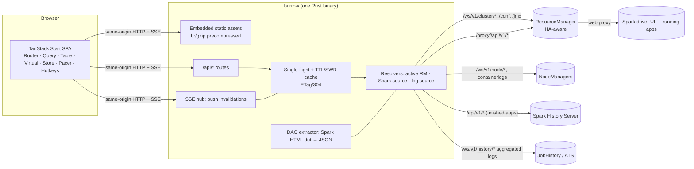

# burrow — PLAN

A ground-up reimagination of the YARN ResourceManager UI **and** the Spark-on-YARN tracking UI, as one
modern app. Once published, `pip install yarn-burrow && burrow` starts a read-only YARN UI and Spark-on-YARN
tracking views — jobs, stages, DAGs, SQL and logs — backed by machine-checked parity coverage and documented scope limits.

> **Package naming:** The GitHub repository and Rust CLI are named `burrow`. The Python distribution is `yarn-burrow` and installs the `burrow` command. The README describes PyPI installation conditionally on publication.
>
> **Status:** all slices are implemented; what is *verified* (with commands and numbers) lives in
> [`docs/verification.md`](docs/verification.md) — read that first for the current state, including the honest
> open-items list. Section 10 below is the build order that was followed, not a to-do list.

---------------------------------------------------------------------------------------------------

## 1. Goals / non-goals

**Goals**
1. **Feature parity with YARN's own UIs** (legacy `/cluster/*` Hamlet UI is the baseline; UI2/Ember is a secondary
   inventory source): cluster about + metrics, applications by category, application + attempt + container pages,
   scheduler/queues (Capacity, Fair, FIFO), nodes, node labels, tools (conf, JMX, stacks, daemon logs).
2. **Spark-on-YARN inside the app page**: the "Tracking UI" becomes native — Jobs, Stages (+task distributions),
   Executors, Storage, Environment, SQL, Streaming, timelines, and **animated live DAGs** (job DAG, stage RDD DAG,
   SQL plan DAG). Works live (RM web-proxy → driver) and historical (Spark History Server).
3. **Container logs** (NodeManager for running, JobHistory/ATS for aggregated) with live follow, search, virtualized.
4. **Modern, fast, beautiful**: TanStack end-to-end on the frontend; Rust on the backend; sub-second everything.
5. **`pip install` distribution**: one self-contained binary per platform inside a wheel. No Python/Node/Java at runtime.
6. **Proof of parity**: automated differential testing against a *real* YARN cluster + the stock YARN UI (§8).

**Non-goals (v1)** — each is a deliberate cut, not an oversight:
- Write actions (kill app, move queue, change priority). Read-only by design; add later behind `--enable-actions`.
- ATS v2 / flow activity, YARN native services UI, Federation/Router pages, MapReduce/Tez-specific job pages (we link out).
- Persisting history of our own (no DB). Cluster utilisation sparklines are session-local.
- Multi-cluster in one process (run one instance per cluster).

---------------------------------------------------------------------------------------------------

## 2. Stack decisions (and what was rejected)

| Layer | Choice | Why |
|---|---|---|
| Frontend framework | **TanStack Start** in **SPA mode** (`spa.enabled`) → static `dist/client` + prerendered `_shell.html` | Requested. SPA mode needs no server runtime; the shell paints instantly; Router/Query/Table plugin chain intact. |
| Routing | **TanStack Router** (file routes, typed + validated search params) | Filters/sort/columns live in the URL → every view is linkable/shareable. |
| Data | **TanStack Query** (`queryOptions`, adaptive polling, `streamedQuery` for logs, SSE-driven invalidation) | |
| Tables | **TanStack Table** + **TanStack Virtual** | 10k+ app rows, task tables, log viewer — all virtualized. |
| Client state | **TanStack Store**; **Pacer** (debounce/throttle search & live updates); **Hotkeys** (⌘K, g-a, g-n …) | |
| UI kit | Tailwind v4 + **Base UI** primitives (headless, a11y) + `motion` | Full design control, no look-alike component kit. |
| Visualisation | Custom **SVG/Canvas** (d3-scale/shape only), **elkjs** layered layout in a Web Worker | DAGs/timelines/gauges must be bespoke to look and animate right. |
| Backend | **Rust**: tokio + hyper/axum + reqwest(rustls) + tower-http | See below. |
| Packaging | **maturin** `bindings="bin"` → `py3-none-<platform>` wheels | Binary lands on `PATH` via pip; web assets embedded in the binary. |
| Python (tooling only) | `uv venv .venv` inside the repo: pyspark workloads, maturin, cluster scripts | Per instruction; never on the runtime path. |
| Tests | Rust: `cargo test` + mock upstreams. Web: vitest + Playwright. Parity: Playwright against live YARN. | |

**Why Rust for the backend** (decided on merits): the backend's real job is *protecting the ResourceManager* and
fanning out to many browser tabs — request coalescing, TTL cache with stale-while-revalidate, SSE fan-out, streaming
log tails, brotli/zstd compression, TLS, and (later) SPNEGO. That is I/O-concurrency + zero-copy byte shuffling:
tokio/hyper territory (tens of MB RSS, no GC pauses, µs cache hits, ~5 MB static binary). maturin makes "wheel containing a
binary" a first-class, cross-compilable flow, and the toolchain (cargo 1.97, maturin) is already here.

**Rejected**
- *Python (FastAPI/uvicorn)* — per direction; GIL-bound fan-out, runtime dependency on a Python ≥3.x on edge nodes.
- *Go* — equally fast and has pure-Go Kerberos (`gokrb5`), but no first-class wheel tooling, no toolchain here. Revisit only if
  dlopen-GSSAPI proves too painful in Rust (§6.6).
- *Start SSR + server functions as the BFF (Bun/Node)* — needs a JS runtime per host (or a ~100 MB `bun --compile` binary),
  single-threaded fan-out, no practical Kerberos. We keep Start but only its SPA output.
- *React Flow for DAGs* — fine library, but we need clusters-in-clusters, flowing-edge animation, semantic zoom and
  500-node perf; a bespoke ELK+SVG renderer is less code than bending React Flow to that.

---------------------------------------------------------------------------------------------------

## 3. Architecture



**Backend principles**
- **Passthrough-first, additive only.** YARN/Spark JSON is forwarded byte-for-byte (cached). The only synthesized
  payloads are `/api/meta`, `/api/spark/*/dag/*`, `/api/spark/*/source`, `/api/logs/*`. This is what makes parity provable.
- **Never amplify load.** N tabs × M resources ⇒ ≤ 1 upstream request per resource per TTL (single-flight). Standby/failed
  upstreams back off; a global per-upstream concurrency cap protects the RM.
- **Push invalidation, pull data.** SSE tells the tab *what changed* (topic + etag); the tab refetches through the cache
  with `If-None-Match`. Polling remains as fallback.
- **Read-only, local-first security**: bind `127.0.0.1`; Host-header allowlist; no CORS; strict CSP; upstream credentials
  never reach the browser; NM/SHS/JHS targets restricted to hosts discovered from RM/config (no open proxy).

**Frontend principles**
- Every YARN datum is rendered through a `Datum` primitive that stamps `data-yf` / `data-yv` (§8) — the parity harness reads
  the DOM, not our code.
- URL is state. Filters, sort, visible columns, selected tab, time range, DAG expansion → search params.
- Live by default: running things visibly progress (tickers, progress, flowing DAG edges); everything honours
  `prefers-reduced-motion`; status is never colour-only.
- Offline-safe: fonts/icons/workers bundled; zero runtime network except same-origin.

---------------------------------------------------------------------------------------------------

## 4. Repository layout

```
burrow/
├─ PLAN.md  DESIGN.md  README.md  LICENSE(MIT)  Makefile
├─ Cargo.toml  pyproject.toml            # workspace; maturin bin wheel
├─ crates/
│  ├─ burrow-core/   # lib: config, hadoop-conf discovery, upstream clients, cache, spark, dag, logs, hub
│  └─ burrow/        # bin: clap CLI (serve · doctor), axum routes, embedded assets
├─ web/                 # TanStack Start (SPA)   → web/dist/client → embedded into the binary
├─ parity/              # inventory/ (YAML, from Hadoop source) · harness/ (Playwright) · report/
├─ cluster/             # test cluster: setup/up/down, conf templates, PySpark workloads, scenarios, capture
├─ fixtures/            # captured real RM/NM/Spark/JHS responses (replayable), per version+scenario
├─ docs/                # contracts/ (api, parity-dom), references/, architecture, parity
├─ .cluster/            # (git-ignored) JDK17, Hadoop 3.4.3, runtime state, logs     [already provisioned]
├─ .venv/               # (git-ignored) uv venv: pyspark 4.2.0, tooling             [already provisioned]
└─ .github/workflows/   # web build → cargo test → maturin wheel matrix → install smoke
```

Shared contracts (must not drift; changing them = tell the integration owner):
- `docs/contracts/api.md` — SPA ↔ backend HTTP/SSE API.
- `docs/contracts/parity-dom.md` — `data-yf` / `data-yv` / `data-ye` DOM convention + field-id grammar.
- `.cluster/endpoints.json` — written by `cluster up`: RM/NM/SHS/JHS URLs, users, version strings. Harnesses read this.
- `fixtures/README.md` — capture/replay format.

---------------------------------------------------------------------------------------------------

## 5. Frontend plan

**Routes** (file-based; search params validated with zod; every list view URL-addressable)
```
/                              Overview: cluster about, metrics, apps-by-state, queue headroom, live utilisation
/apps                          Applications: category tabs (All · Active · New · Submitted · Accepted · Running · Finished ·
                               Failed · Killed + final-status facets), filters, column chooser, 10k-row virtual table
/apps/$appId                   Application: overview · attempts+containers · Spark ▸ · logs · diagnostics
  /spark/{jobs,jobs/$id,stages,stages/$id/$attempt,executors,storage,environment,sql,sql/$id,streaming,timeline}
  /attempts/$attemptId   /containers/$containerId   /logs
/scheduler  /scheduler/$queue  Queue tree: capacity/used/max/headroom, users, AM limits, partitions, per-queue apps
/nodes  /nodes/$nodeId         Table + rack/heatmap views, state tabs; node detail
/node-labels
/tools/{conf,jmx,stacks,logs}  RM daemon pages (searchable config viewer, JMX tree, stacks, log tail)
```

**TanStack usage map** — Start (shell, build), Router (routes, search params, loaders prefetching via Query),
Query (all server state; `refetchInterval` adaptive: fast when visible+running, paused when hidden; SSE invalidation;
`streamedQuery` for log follow), Table+Virtual (apps, nodes, jobs, stages, tasks, executors, logs), Store (theme, density,
time-zone, live-pause, sampled utilisation history), Pacer (debounced search, throttled live-diff application),
Hotkeys (command palette, vim-ish nav), Devtools (dev only). Form/DB/Ranger only if a concrete need appears.

**Visual direction** (details in `DESIGN.md`, authored in Phase 1): dark-first "ops console", light theme equal-class;
OKLCH token system; Inter Variable + JetBrains Mono Variable (self-hosted); tabular numerals everywhere; dense but calm.
- *Live status language*: one status→colour+icon+motion table used by lists, DAG, timelines.
- *Overview*: number tickers, resource rings, queue-headroom bars, sparkline history, "now running" rail.
- *DAG (hero)*: ELK layered layout in a worker; stages as compound nodes containing RDD operator chains; per-stage
  segmented progress (done/active/failed/pending tasks); flowing dashed edges while upstream is active; shuffle badges
  (read/write bytes); skipped stages ghosted; semantic zoom (job → stage → RDD); minimap; pan/zoom; click → drawer with
  stage metrics. SQL plan DAG: same renderer, nodes carry metrics. Everything animates on state change, 60 fps, reduced-motion safe.
- *Timelines*: executor add/remove + job/stage Gantt; per-stage task timeline (Canvas, virtualized rows) with
  deserialize/compute/shuffle/GC phase colouring.
- *Logs*: virtualized, ANSI + level colouring, regex search with match navigation, follow mode, jump-to-error, wrap, download.

**Budgets**: initial JS ≤ 300 KB gz (route-split; ELK/viz lazy); apps table 10k rows @ 60 fps scroll, no long task > 50 ms;
DAG ≤ 300 nodes lays out < 200 ms off-thread; a11y: keyboard-complete, AA contrast, focus-visible, reduced-motion.

---------------------------------------------------------------------------------------------------

## 6. Backend plan

### 6.1 CLI
`burrow [serve]` · `burrow doctor` (probe RM/NM/SHS/JHS; print versions, HA state, what features will light up).
Config precedence: flags > `BURROW_*` env > `--config` TOML > **Hadoop conf auto-discovery** (`HADOOP_CONF_DIR`/`YARN_CONF_DIR`/
`/etc/hadoop/conf`: `yarn.resourcemanager.webapp.address`, HA `rm-ids`, `yarn.http.policy`, `yarn.log.server.url`,
timeline address; `spark-defaults.conf`: `spark.yarn.historyServer.address`) > `http://localhost:8088`.
Flags: `--rm URL…` (repeat = HA), `--spark-history URL`, `--jhs URL`, `--bind/--port` (default `127.0.0.1:8787`), `--no-open`,
`--user NAME` (simple auth `user.name`), `--header K:V`, `--ca-cert`, `--insecure`, `--token`, `--base-path`.

### 6.2 Upstream layer
reqwest+rustls pools per upstream; timeouts; per-upstream semaphore; RM HA: probe `/ws/v1/cluster/info` `haState`, follow 307 to
active, remember, back off failed; safe retry of idempotent GETs on connect errors only.

### 6.3 Cache & coalescing
Key = (upstream, path, canonical query). Single-flight; TTL per route class (cluster metrics 1 s · apps 2 s · running-app detail 1 s ·
finished-app detail 60 s · nodes/scheduler 3–5 s · conf 60 s · finished Spark data ≈ immutable); stale-while-revalidate on upstream error;
weak ETag from body hash → 304; `x-burrow-cache: hit|miss|stale|coalesced|bypass`; `Cache-Control: no-cache` bypasses (used by parity).

### 6.4 SSE hub (Phase 2)
`GET /api/events?topics=…` → `invalidate` events `{topic, etag, at}`. A topic polls its upstream **only while subscribed**, at a
topic-specific interval, and emits only when the body hash changes. 15 s heartbeat. One EventSource per tab.

### 6.5 Spark integration
Resolver picks the Spark REST base per app: RUNNING → `{rm}/proxy/{appId}/` (handles the web-proxy `proxyapproved` handshake);
FINISHED/FAILED/KILLED → History Server (`--spark-history`, else derived from the app's tracking URL / Spark conf). Normalises
cluster-mode attempt ids. Route allowlist mirrors Spark's REST (§ contract). **DAG**: Spark's REST does not expose the RDD operation
graph; the job/stage HTML pages embed it as DOT in `#dag-viz-metadata` — the backend parses that (never forwards HTML) into JSON
(`/dag/jobs/{id}`, `/dag/stages/{id}/{attempt}`), unit-tested against fixtures from **Spark 3.5.x and 4.x**. Fallback: stage-level DAG
from REST. SQL DAG comes from `/sql/{id}?details=true&planDescription=true`. *(Discovery task confirms what REST really exposes.)*

### 6.6 Logs
Running: NM REST (`/ws/v1/node/containers/{id}`, `containerlogs`), range reads + tail-N; follow = server-side offset polling → SSE.
Finished: JHS/ATS aggregated-log web services. Node/host targets only from RM-known nodes. UTF-8-lossy, size-capped, `nosniff`.

### 6.7 Auth & security
Simple auth (`user.name`), arbitrary headers/bearer, custom CA/insecure TLS in v1. **Kerberos/SPNEGO**: `dlopen` system `libgssapi_krb5`
(`libloading`, ~6 symbols) behind a runtime check — wheels stay manylinux-clean; verified against an MIT KDC in a podman container
(stretch milestone; if unverified it ships off and says so).

### 6.8 Backend budgets (measured in Phase 4)
200 concurrent identical GETs ⇒ exactly 1 upstream; cached GET p99 < 5 ms @ 1k rps; idle RSS < 50 MB; startup-to-listening < 200 ms;
unchanged poll ⇒ 304 with empty body; wheel < 15 MB.

---------------------------------------------------------------------------------------------------

## 7. Test cluster (real YARN — the ground truth)

Provisioned: Temurin JDK 17, Hadoop 3.4.3 (incl. Java sources of every legacy RM UI block + compiled UI2), pyspark 4.2.0 in `.venv`.
Built by the Cluster slice (`cluster/`): `make cluster-up|down|status`.

- **Topology** (one host, memory-capped for a 14 GB box): RM + 3 NodeManagers each bound to its own loopback IP
  (127.0.0.2/3/4 ⇒ distinct hosts, racks via topology script), JobHistory Server (aggregated logs on local FS), Spark History Server,
  Capacity Scheduler with a real queue tree (nested queues, ACLs, max-capacity, small AM-limit to force PENDING), node labels,
  log aggregation on, `ui2` enabled. Optional second scheduler config (Fair) for scheduler-page parity.
- **Scenarios** (each captured as a replayable fixture set): finished (SUCCEEDED) · failed (app exception, diagnostics) · killed ·
  running (long, multi-stage, shuffle, cache, SQL/AQE, skew, task retries) · accepted/pending (queue/AM limit) · multi-attempt
  (AM killed → attempt 2) · multiple users (`HADOOP_USER_NAME`) · tags · priorities · label expressions · preempted (if reproducible) ·
  Spark 3.5.9 variant for DAG/REST compat · structured streaming/long-running for live demos.
- `.cluster/endpoints.json` is the contract for everything downstream.

---------------------------------------------------------------------------------------------------

## 8. Verification programme — "exactly matches YARN, nothing missing"

Definition: for every field *F* that a YARN UI shows, `legacyText(F)` ≡ `format(REST[F])` ≡ `ours(F)`, modulo explicitly
documented normalisers (e.g. `-1` ⇄ `N/A`, date formats). Four independent proofs:

**P0 — Inventory (ground truth, from source, not memory).** Extract from the Hadoop 3.4.3 sources jars (`RMWebApp`, `AboutBlock`,
`MetricsOverviewTable`, `RMAppsBlock`, `RMAppBlock`, `RMAppAttemptBlock`, `RMContainerBlock`, `NodesPage`, `CapacitySchedulerPage`,
`FairSchedulerPage`, `DefaultSchedulerPage`, `NodeLabelsPage`, `NavBlock`, `RMErrorsAndWarningsPage`, `AppLogAggregationStatusPage`, …) and the
`*Info` DAOs + `RMWebServices` every legacy page, section, label, column, conditional and its REST source; likewise UI2's pages/models, and the
RM/NM REST docs. Output: `parity/inventory/*.yaml` (+ human-readable `docs/parity.md`). Every item gets a stable **field id**.

**P1 — REST coverage ("no key left behind").** Crawl the live RM/NM/Spark endpoints across all scenarios; collect every JSON key path
observed. The browser harness collects every `data-yf` rendered across a full UI crawl. Assert `observed ⊆ rendered ∪ waived`.
Waivers live in `parity/waivers.yaml`, each with a reason (`internal`, `deprecated`, `secret`, `rendered-elsewhere`, …) — no silent skips.
Unknown new keys fail the build (zod `strict` in test mode).

**P2 — Value parity vs the stock UI (differential).** Playwright drives the **real legacy YARN UI** (`/cluster/cluster`, `/cluster/apps/<STATE>`,
`/cluster/app/<id>`, `/cluster/appattempt/<id>`, `/cluster/nodes`, `/cluster/scheduler`, `/cluster/nodelabels`, `/conf`, …) and scrapes
label→text pairs and DataTables arrays; then crawls *our* UI for the same entities and reads `data-yv`. Per-field normalisers → compare.
Run across **every scenario**. Output: `parity/report/index.html` (page × field × {match | mismatch | waived}) + `summary.json`.

**P3 — Wire fidelity.** For every proxied endpoint: RM-direct JSON ≡ through-burrow JSON (deep-equal, `no-cache`) — proves the cache/proxy
adds/drops nothing. For Spark: our rendered Jobs/Stages/Executors/Storage/Environment/SQL values ≡ Spark's own REST *and* scraped Spark UI HTML.

**Exit criteria** (gate for "done"): 0 unmapped legacy labels · 0 unrendered REST keys outside waivers · 0 value mismatches across all scenarios ·
P3 green · harness has a fixture-replay mode so CI runs it without Java.

---------------------------------------------------------------------------------------------------

## 9. Packaging & distribution

- `pyproject.toml`: `build-backend = "maturin"`, `bindings = "bin"`, `manifest-path = crates/burrow/Cargo.toml`, `requires-python >= 3.8`,
  no Python deps. Wheels: manylinux2014 x86_64/aarch64, musllinux x86_64, macOS arm64/x86_64, Windows x64 (CI matrix via `maturin-action`).
  Locally verified: linux x86_64.
- Web assets: `bun run build` → `web/dist/client` → compressed (br/gz) → embedded via `rust-embed` (release) / read from disk (debug).
  sdist includes the prebuilt assets so `pip install` from source needs Rust only.
- Install smoke: fresh `uv venv` → `pip install <wheel>` → `burrow --version` → `burrow doctor` → serve → load `/`, `/api/meta`,
  `/api/yarn/info` against the live test cluster.
- Release: tag → CI builds + smoke-tests wheels → `maturin upload` (credentials are the owner's; not done here).

---------------------------------------------------------------------------------------------------

## 10. Phases, slices, and gates

**Phase 0 — foundations.** Plan, contracts, repo, JDK/Hadoop/PySpark provisioned. ✔ complete.

**Phase 1 — parallel foundations** (disjoint ownership; coordinate only via the contracts)
| Slice | Owns | Done when |
|---|---|---|
| A Cluster | `cluster/`, `.cluster/` runtime | `make cluster-up` ⇒ RM+3 NM+JHS+SHS healthy; PySpark `--master yarn` SUCCEEDED; logs aggregated; `endpoints.json` written |
| B Inventory | `parity/inventory/`, `docs/parity.md` | every legacy page/label/column + UI2 + REST DAO field catalogued with field ids, REST source, condition |
| C Spark discovery | `docs/spark-rest-and-dag.md`, `fixtures/spark/` | proves exactly what REST exposes (jobs/stages/executors/sql/…), where DAG data lives, 3.5.x vs 4.x deltas; real fixtures |
| D Backend core | `Cargo.toml`, `crates/`, `pyproject.toml` | passthrough+cache+coalescing+static+meta+Hadoop-conf discovery; mock-upstream integration tests green |
| E Web foundation | `web/`, `DESIGN.md` | Start SPA builds; design system + app shell + typed API layer + `Datum`; route stubs; vitest/Playwright wired |

**Phase 2 — feature slices** (parallel, each owns routes/components + its backend endpoints):
Overview+Scheduler · Apps list+App detail · Nodes+Labels+Tools · Spark tables (jobs/stages/executors/storage/env/sql) ·
DAG+timeline visualisations (+ backend DAG extractor) · Logs (+ backend log routes + SSE follow) · SSE hub.

**Phase 3 — parity.** Harness (P1–P3), scenario capture/replay, loop: run → fix mismatches/gaps → re-run until exit criteria.

**Phase 4 — hardening & ship.** Perf measurements vs budgets · a11y pass · error/empty/stale states (RM down, no SHS, partial data) ·
HA failover tests (mock) · Kerberos (stretch) · `--base-path` · wheel build + clean-venv install smoke · CI · README/docs · screenshots.

**Phase 5 — stretch.** Write actions (`--enable-actions`), Hadoop 3.3.6/3.5.0 + Spark 3.5.9 compat matrix in CI, multi-cluster.

---------------------------------------------------------------------------------------------------

## 11. Risks & mitigations

| Risk | Mitigation |
|---|---|
| Spark DAG not in REST | HTML-dot extraction + fixtures per Spark version + REST stage-level fallback; Discovery slice settles it first |
| RM web-proxy quirks (approval cookie, ACLs) for live Spark | Resolver implements handshake; verified on live cluster; clear "why unavailable" reasons in `/api/spark/*/source` |
| Hadoop/Spark/JDK version coupling | JDK17 for all; fall back to per-daemon `JAVA_HOME` + `spark.*.env.JAVA_HOME`; compat matrix in Phase 5 |
| 14 GB host | daemon heaps capped; small executors; cluster scripts refuse to start if free RAM < threshold |
| Aggregated logs need JHS | `doctor` explains; NM logs still work for running/recent containers |
| HA RM can't be live-tested cheaply | mock-upstream failover tests; documented as not live-verified |
| Kerberos | dlopen design, KDC-in-podman test; ships disabled-with-message if not verified |
| Scope vs "done" | Non-goals are explicit; stretch items are labelled and never claimed unless exercised |
