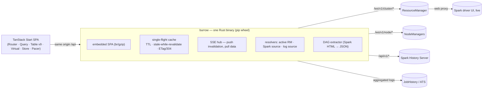

# Burrow

<p align="center">
  
</p>

[](https://www.rust-lang.org/)
[](https://bun.sh/)
[](https://react.dev/)
[](https://tanstack.com/)
[](https://vitest.dev/)
[](https://playwright.dev/)
[](LICENSE)

**A modern UI for Apache Hadoop YARN and Spark-on-YARN — built from the same REST APIs the stock UI uses, with
a machine-checked proof that nothing is lost.**

`pip install burrow && burrow` puts one self-contained binary on your `PATH`, starts a read-only server on
`127.0.0.1`, and opens a browser onto your ResourceManager: applications by state, queue freeness, nodes, the
scheduler, every RM/NM daemon page — and, inside each application, the full Spark experience the Tracking UI
gives you (jobs, stages, executors, SQL, streaming, container logs) plus animated live DAGs.

No Python, Node, or Java is required at runtime. Bun is used for frontend development and verification only. No write
actions. Nothing leaves your machine.

```
pip install burrow
burrow doctor        # what does this deployment expose?
burrow               # serve UI + API on http://127.0.0.1:8787
```

## Stack

| Layer | Technologies |
|---|---|
| Server | Rust 2024, Tokio, Axum; one read-only binary with embedded web assets |
| UI | React 19, TypeScript, TanStack Start/Router/Query/Store/Table/Virtual/Pacer, Vite, Tailwind CSS 4, ELK.js |
| Development and tests | Bun, Vitest + Testing Library, Playwright, Biome, Cargo tests, Clippy, rustfmt |
| Packaging | Maturin-built PyPI wheel containing the Rust binary; Bun is not required to serve the installed app |

> Status: this repository is the working tree described in `PLAN.md`; everything below is implemented and verified
> against a real Hadoop 3.4.3 cluster with PySpark 4.2.0 (see *Verification* for the evidence trail).

---

## What you get

| Area | Contents |
|---|---|
| **Overview** (`/`) | Cluster identity and HA state, the RM's full Cluster Metrics (apps per state, containers, resources, utilisation) with live tickers, node-state counts, scheduler snapshot, "now running" rail, per-service health |
| **Applications** (`/apps`) | All legacy categories (New → New Saving → Submitted → Accepted → Running → Finished → Failed → Killed) + final-status facets, every legacy column (24), per-user/queue/type/tag/time filters, virtualised rows, CSV/JSON export, URL-addressable state |
| **Application** (`/apps/$appId`) | Every datum the legacy app page shows (priority, queue, timing, timeouts, diagnostics, label expressions, preemption and aggregate-allocation metrics), a status timeline, attempts with AM containers, container detail, log links |
| **Spark** (`/apps/$appId/spark/*`) | Jobs, Job detail **with the stage DAG**, Stages, Stage detail (task distributions, quantiles, per-task table with paging/filtering) **with the RDD operation DAG**, Executors, Storage/RDDs, Environment, SQL (execution list + plan DAG), Streaming, Timeline. Live apps read through the RM web proxy; finished apps read from the Spark History Server |
| **Scheduler** (`/scheduler`) | Capacity / Fair / FIFO, queue tree with **freeness** (used vs guaranteed share vs maxCapacity), headroom, per-queue users/apps/partitions, scheduler activities, health, scheduler config, treemap |
| **Nodes** (`/nodes`, `/node-labels`) | All 16 legacy columns, state tabs, label/rack filters, utilisation heatmap, top consumers, node detail with the resource matrix, NM info and live container list; label catalogue + read-only mapping matrix |
| **Tools** (`/tools/*`) | Configuration (searchable, overridden-only filter, diff highlighting), JMX tree, live thread stacks, daemon logs — plus every NM's own conf/jmx |
| **Logs** (`/apps/$appId/logs`) | Container stdout/stderr for running containers (via the NodeManager) and finished ones (via JobHistory aggregation), byte-addressed, ANSI-aware, level-filtered, searchable, with **live follow** over SSE; virtualised to a million lines |

Design language, tokens and motion rules live in [`DESIGN.md`](DESIGN.md); the DAG's visual language in
[`docs/design-dag.md`](docs/design-dag.md).

## Architecture



- **Passthrough first, additive only.** YARN and Spark JSON is forwarded byte-for-byte (cached). Only `/api/meta`,
  `/api/events`, `/api/logs/*` and the DAG routes synthesise payloads. That is what makes the parity proof possible.
- **Never amplify load on the ResourceManager.** N tabs × M resources ⇒ ≤ 1 upstream request per resource per TTL
  (single-flight); SSE tells tabs *what* changed, the cache serves the bytes; a per-upstream concurrency cap and
  backoff protect a struggling RM.
- **Read-only and local by default.** Binds `127.0.0.1`, Host-header allowlist, strict CSP with a per-response
  nonce, no CORS, upstream credentials never reach the browser, NodeManager targets are restricted to hosts the RM
  itself reports.
- **Live by design.** Running things poll fast and animate (stage progress, flowing DAG edges, ticking durations);
  nothing animates under `prefers-reduced-motion`, and `?parity=1` freezes all motion and exposes the raw values.

## Verification

The project treats "matches YARN" as a testable claim, not a slogan. Against a live single-host cluster
(RM + 3 NodeManagers + JobHistory + Spark History) the harness in [`parity/`](parity/) runs three independent proofs:

- **P1 — REST coverage:** every JSON key path the live RM/NM emits is declared by the source-derived inventory
  ([`parity/inventory`](parity/inventory), built from Hadoop's own Java sources) or explicitly waived with a reason.
- **P2 — differential value parity:** Playwright drives the stock Hamlet UI and our SPA, and compares
  `legacy text ≡ our raw value ≡ the REST value` field by field, per page, across every seeded scenario
  (succeeded, failed, killed, pending, multi-attempt, multiple users, tags, priorities, label expressions,
  MapReduce, distributed-shell, a 5 MB log app and more).
- **P3 — wire fidelity:** for every proxied endpoint, direct-upstream bytes ≡ bytes through burrow.

Additional gates: **Vitest** unit/component tests with Testing Library, Rust unit and integration tests (including
live-cluster passthrough and failover), **Playwright** end-to-end tests in Chromium and Firefox, TypeScript checks,
**Biome**, Clippy, rustfmt, a gzipped initial-JS budget of ≤ 300 KB, and a parity self-test that corrupts a fixture
and expects the harness to fail. [`docs/verification.md`](docs/verification.md) records actual runs and known limitations.

Reproduce everything (build SPA → embed → serve → parity):

```bash
make cluster-up          # test cluster (Hadoop 3.4.3 + PySpark workloads)
make cluster-seed        # the scenario matrix
make acceptance          # build + serve + P1/P2/P3, writes parity/report/index.html
```

## Install & packaging

```bash
pip install burrow            # or: uv tool install burrow
burrow doctor                 # probes configured services and discovers addresses from the live RM
burrow --help                 # every flag: --rm (repeatable, HA order), --spark-history/--jhs (repeatable), --user,
                                 # --header, --ca-cert, --insecure, --token, --bind/--port, --assets-dir, --base-path
```

Configuration precedence: flags → `BURROW_*` env → `--config` TOML → **Hadoop conf auto-discovery**
(`HADOOP_CONF_DIR`/`YARN_CONF_DIR`/`/etc/hadoop/conf`: `yarn.resourcemanager.webapp.address`, HA `rm-ids`,
`yarn.http.policy`, `yarn.log.server.url`; `spark-defaults.conf`: `spark.yarn.historyServer.address`) → `localhost:8088`.

At startup, Burrow also reads the active ResourceManager's effective configuration and recent finished-app tracking
links. Effective RM settings for JobHistory and Spark History are added as fallback endpoints. Tracking links are shown
by `burrow doctor` as candidates. If a link goes through the RM web proxy, Burrow inspects the redirect from the
RM but does not follow or contact its destination. When a cluster advertises different JobHistory or Spark History
servers, configure all trusted endpoints with repeatable flags or TOML arrays, for example
`--jhs http://jhs-3a:19888 --jhs http://jhs-4a:19888` and `--spark-history http://shs-a:18080,http://shs-b:18080`.

Wheels are built with [maturin](https://www.maturin.rs) (`bindings = "bin"`, `py3-none-<platform>`): the binary is
the package, so there is nothing to compile or configure at install time. Release builds embed the SPA (with
brotli/gzip sidecars) into the executable.

## Development

```bash
make venv                # uv venv + pyspark + maturin (Python tooling only; the runtime is Rust)
make web-install         # bun install
make web-dev             # SPA dev server against the mock API (no cluster needed)
make backend             # cargo build -p burrow
make test                # cargo test --workspace + vitest
make lint fmt            # clippy -D warnings, rustfmt, biome
make wheel install-smoke # build the wheel, install it into a throwaway venv, prove it serves
```

Repository layout: `crates/burrow-core` (config, upstream clients, cache, YARN/Spark/log routes), `crates/burrow`
(CLI, HTTP layer, embedded assets), `web/` (TanStack Start SPA), `parity/` (inventory + harness), `cluster/` (test-cluster
CLI and PySpark workloads), `fixtures/` (captured real payloads), `docs/` (contracts, architecture, parity report).

Contracts that hold the seams (read these before changing the shape of anything):
[`docs/contracts/api.md`](docs/contracts/api.md) (SPA ↔ backend) and
[`docs/contracts/parity-dom.md`](docs/contracts/parity-dom.md) (the `data-yf`/`data-yv` DOM contract the harness reads).

## Deliberate limits (v1)

- **Read-only.** No kill/move-queue/priority actions; no write endpoints at all.
- **Kerberos/SPNEGO is not implemented** — simple auth (`user.name`), custom headers, bearer tokens, TLS with custom
  CAs and HA RM pairs are supported today. (`features.kerberos` reports `false` honestly.)
- **ATS v2 / flow activity, YARN services, Federation** are out of scope; UI2-only pages are catalogued and waived in
  the inventory rather than silently missing.
- **Non-Spark apps** (MapReduce, distributed-shell) get full YARN treatment; there is no MR job-level view.

## License

MIT. YARN and Spark are trademarks of the Apache Software Foundation; this project is an independent UI.
