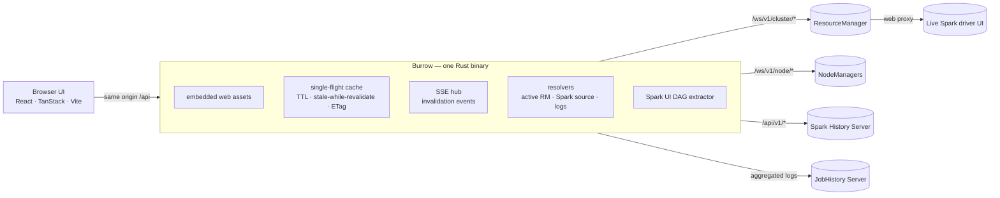

# Architecture overview

Burrow is a local web application backed by one Rust binary. The binary serves the embedded frontend and a same-origin API, then connects to the configured or discovered Hadoop and Spark services.

## Design principles

- **Pass through first.** YARN and Spark JSON responses are forwarded byte-for-byte and cached. Burrow synthesizes only the metadata, event, log and DAG endpoints needed by the UI.
- **Share upstream work.** Concurrent tabs requesting the same resource share a fetch within the cache policy. Server-sent events tell the UI what changed; per-upstream concurrency limits and backoff help protect a busy ResourceManager.
- **Read-only and local by default.** Burrow binds to `127.0.0.1`, validates Host headers, uses a per-response CSP nonce, does not enable CORS, keeps upstream credentials on the server, and restricts NodeManager targets to hosts reported by the ResourceManager.
- **Respect reduced motion.** Live status and DAG progress can animate. The UI honors `prefers-reduced-motion`; `?parity=1` freezes motion and exposes raw values for parity checks.

## Implementation stack

| Layer | Technologies |
|---|---|
| Server | Rust 2024, Tokio and Axum; a read-only binary with embedded web assets |
| UI | React 19, TypeScript, TanStack Start/Router/Query/Store/Table/Virtual/Pacer/Hotkeys, Vite, Tailwind CSS 4, Base UI, Motion, D3 scale/shape and ELK.js |
| Development and verification | Bun, Vitest, Testing Library, Playwright, Biome, Cargo tests, Clippy and rustfmt |
| Packaging | Maturin-built `yarn-burrow` platform wheel containing the Rust binary and embedded web assets |

For the module map, cache behavior, ResourceManager HA, request flow and deeper security decisions, see [backend architecture](architecture-backend.md). The frontend/backend boundary is documented in the [API contract](contracts/api.md).
